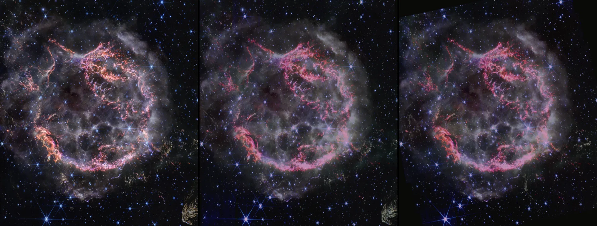

# Cassiopeia A, 2025

Webb's NIRCam mosaic of the supernova remnant Cassiopeia A of 2025 October 25 (JWST program 7934), three years after the
2022 mosaic ESA/Webb made its picture from, drawn as the same shell as the [2022 bank](../cassiopeia-a-layers/README.md).
**No published picture of this mosaic exists: its colors are fitted here to ESA/Webb's 2022 picture of the same filters,
not ESA's own processing.** Everything about the shell (the forward shock's sphere, the ejecta at the depths their
measured speeds give, the far view) is the 2022 bank's, and its README explains it.

## Sources

| Selected source | Input and meaning |
| --- | --- |
| [JWST program 7934](https://www.stsci.edu/jwst/science-execution/program-information?id=7934) | [Record](../../sources/mast-jwst-7934-nircam-cassiopeia-a.json). "A Deep, High Resolution NIRCam Mosaic of Cas A" (PI R. A. Fesen): level-3 mosaics `jw07934-o001_t001_nircam` in F150W2-F162M, F356W and F444W (and F070W, not used), taken on 2025 October 25 and public on MAST since 2026 October 26. Flux in MJy/sr. |
| [JWST program 1947](https://www.stsci.edu/jwst/science-execution/program-information?id=1947) | [Record](../../sources/mast-jwst-1947-nircam-cassiopeia-a.json). The 2022 November 5 mosaics in the same three filters (PI D. Milisavljevic), which ESA's picture was made from; read only to fit the colors. |
| [ESA/Webb weic2330a](https://esawebb.org/images/weic2330a/) | [Record](../../sources/esawebb-weic2330a.json). The 2022 picture: 1.62, 3.56 and 4.44 µm as blue, green and red. Its pixels are the 2025 picture's pixels. |
| [DeLaney et al. (2010)](https://arxiv.org/abs/1011.3858) and [the Chandra X-ray Center's model files](https://chandra.harvard.edu/resources/illustrations/3d_files.html) | The ejecta's depths, as in the 2022 bank. `source/ejecta-speeds.dat` is built by [ejecta-speeds.mts](../../../packages/bake/authoring/cassiopeia-a/ejecta-speeds.mts) `--bank=cassiopeia-a-2025-layers`: free expansion from 1671.3 grows the [Ar II] surface by 1.0084 from the 2022 picture, and the outer knots and jets by 1.0494 and 1.0106 from their own epochs. The forward shock's outline is grown to 2025.814 by 1.0717. |

## The picture

[nircam-2025-picture.mts](../../../packages/bake/authoring/cassiopeia-a/nircam-2025-picture.mts) builds `source/source.jpg`
(3493 × 4000 px, restored from the source cache) from the six mosaics' science units, read by byte range from MAST into
`.local/nircam/` (2.0 GB; not restored or mirrored: the manifest states each range).

- **Pixels:** the 2022 picture's, from its sky tags (0.1045 arcsec a pixel, north 27.16° right of vertical), moved by the
  offset at which the 2022 picture's red follows the 2022 F444W flux most closely: 2.25 and 0.25 px (0.24 arcsec), R² 0.927.
- **Colors:** each channel is a sum of curves of the logarithm of filters' flux, each curve the median level in 48 bins of
  equal count, fitted on every second pixel of the 2022 picture against the 2022 mosaics: red from F444W (R² 0.929), green
  from F356W (0.886), blue from F162M and F356W (0.890). The same curves turn the 2025 flux into the 2025 picture.
- **Gaps:** where any of the three 2025 mosaics holds no data, the picture is black: 8.5% of its pixels, at the frame's
  edges, a few detector gaps and saturated star cores.
- **Stars:** removed by NOX as in the 2022 bank (`node labs/nebula/run.mts remove-stars src/objects/cassiopeia-a-2025-layers --from=source.jpg --star-red-over-blue=0.8 --spike-lines=4`):
  of 37,954 patches NOX took, 26,979 were star-colored; 509,713 px were given back as the remnant's. Its spike pass found
  no bright stars to take out, because the 2025 picture's saturated cores are black where the 2022 picture's are white.

## Evidence

Left, ESA/Webb's 2022 picture; middle, the fitted colors on the 2022 mosaics; right, the same colors on the 2025
mosaics, all resampled to 0.25 arcsec (a scratch version of the fit, on 2026-10-28). The fit's own numbers are the
script's, above: the offset and the three R². The bake writes 6 retained images, 7.6 MB, beside the 2022 bank's 4.9 MB.
The page opens with the dataset listed and draws it on the shell, in this worktree's dev site, with no console errors.

## Known problems

- The colors are a fit. A tenth of each channel's variance is left unexplained, and whatever ESA did by hand to parts of
  its 2022 picture is not reproduced: next to the 2022 dataset, a difference can be the fit as well as three years.
- The geometry is the 2022 bank's: the ejecta's depths and the sphere are grown to 2025 by free expansion, not measured
  again.
- The black gaps lie on the shell like the rest of the picture.
- The brightest stars keep their spikes; their black cores show as dark points.
