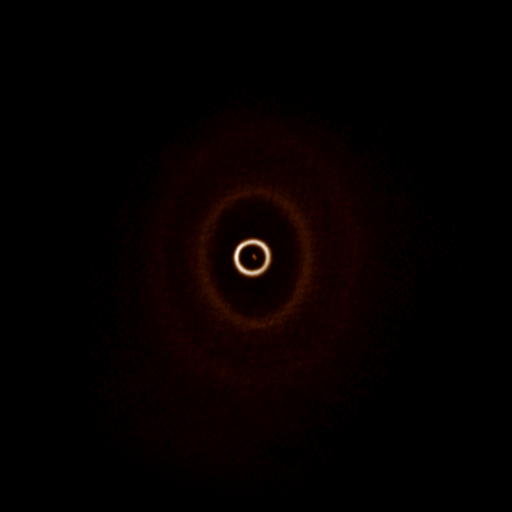
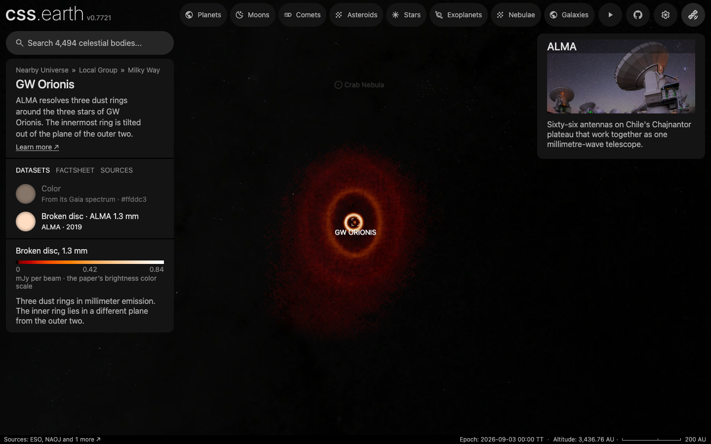
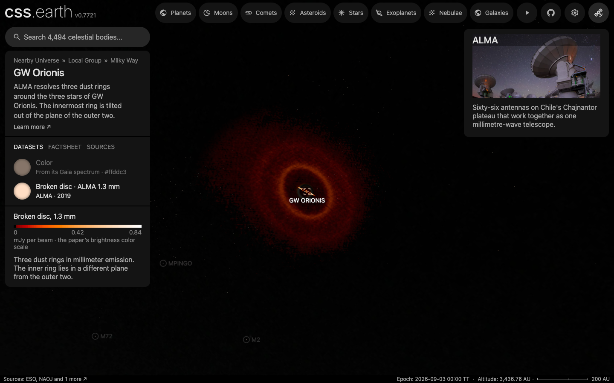
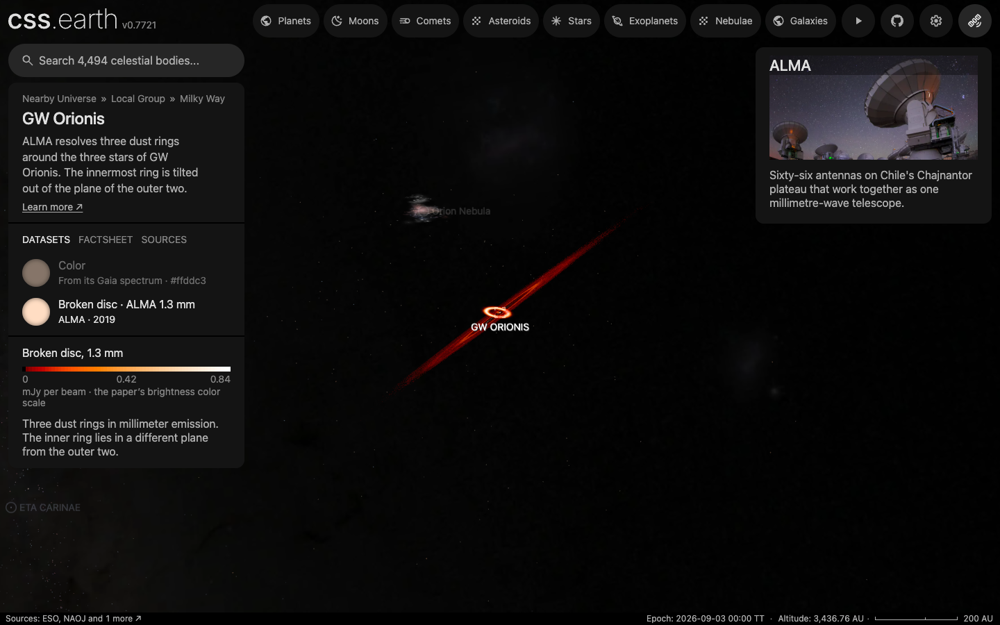

# GW Orionis’s broken disc

This package draws the three dust rings around the triple star [GW Orionis](../gw-orionis/README.md) in their own emission at 1.3 millimeters. The authors’ ALMA image supplies every sky column’s brightness. Two published planes place those columns in three dimensions: the outer rings share one, and the inner ring lies in another, 49° from it. The prepared volume uses the existing star-attached disc renderer.

## Sources

| Input | Meaning and selection |
| --- | --- |
| [Kraus et al. deposit, SourceForge project aba4633](https://sourceforge.net/projects/aba4633/) | The unchanged `ALMA/kraus.gwori.ALMA.fits`: the paper’s own self-calibrated 1.3 mm continuum image, from ALMA projects 2018.1.00813.S (5 July 2019) and 2012.1.00496.S. The deposit states no license; see [NOTICE.md](NOTICE.md). |
| [Kraus et al. (2020), Science 369, 1233](https://doi.org/10.1126/science.aba4633), Table S6 | Ring R2: radius 182 ± 12 au, inclination 143 ± 1°, node at position angle 180 ± 4°. Ring R1: 351 ± 12 au, 142 ± 1°, 180 ± 8°. Ring R3, with the scattered-light constraints: inclination 155 ± 16°, node at 285 ± 30°, eccentricity 0.3 ± 0.1, centre 26.2 mas east and 5.4 mas south of the stars. |
| The same paper, Figure S10 and main text | Which side of each plane is nearer: the outer rings’ eastern side, the inner ring’s southern side. |
| The same paper, Figure 1A | The brightness color scale, read from the figure’s color bar. |

The image has 4096 × 4096 pixels of 4.9 mas and a 24.9 × 19.9 mas restoring beam at −14.7°. Its values are Jy per beam, not visible color. Its header’s `DATE-OBS`, 2015-05-14, is the first of the combined observations.

The [recipe](source/circumstellar.json) fixes these inputs and the display choices. One volume unit is one astronomical unit at the paper’s 388 pc. An inclination above 90° in Table S6 is a retrograde ring; the recipe states each plane as its tilt from face-on (37° and 25°), its line of nodes and its nearer side.

## Evidence

- **Image against the paper.** The noise measured here is 11.53 µJy per beam in an empty annulus 2.5″ to 3.5″ from the star, and the peak is 0.837 mJy per beam. The image’s reference pixel is 80 mas north of the star, so the star is placed from its Gaia DR3 position and proper motion on the header’s date, at native pixel `(2049.45, 2031.82)`. Ridge ellipses then measure the middle ring at 180 au, tilted 36.9°, nodes at 1.3°, and the outer ring at 331 au, tilted 34.1°, nodes at 179.4°; their centres lie 13 and 12 mas from the star. The inner ring’s ridge is 42.4 au from its published centre, against the paper’s 43.3 ± 1.1, at 62 times the noise. The two ridge ellipses are from a scratch run of the author’s own ridge reader and are not kept as a record; the inner ring’s figures are in the [processing record](source/provenance.json).
- **Angle between the planes.** Table S6’s values give 48.9°. Drawing its errors at random gives 37° to 62° for two draws in three.
- **Spatial prior.** The two-plane model projects to the image with an RMS residual of 14.9 µJy per beam, against a signal of 74.4. A single Gaussian belt leaves 52.3, a spherical shell 47.7 and constant depth 55.3. These comparisons use the same image samples and 384 line-of-sight samples; they select a spatial approximation, not a measured third axis.
- **Inner ring’s share of the light.** The image’s median brightness in circles about the ring’s published centre falls to its lowest, 2.4 times the noise, 89 au out. The ring’s light is what stands above that level inside that radius; the outer disc’s profile is measured on the image less it. It is drawn as one sheet on its own plane, which holds the star. Its height is not drawn: the only one published is the 10% of its radius that the paper’s scattered-light model gives its ring, 4.7 au at 47 au, and that model is of the small grains seen in scattered light, not of the millimeter dust this image shows.
- **Brightness colors.** 256 colors read up the figure’s color bar; its nine printed flux ticks calibrate a power display of 0.285 through zero, from 0 to 0.839 mJy per beam. Six ticks fit the curve; the withheld 0.6 and 0.2 mJy-per-beam ticks differ by 0.26 and 0.16 µJy per beam, and the worst of all eight is 0.41.
- **Opacity.** A column keeps the scale’s hue, and its opacity follows its brightness across the scale’s range. The median drawn line of sight is 0.125 opaque, nine in ten are under 0.25, and the brightest reaches 0.95.
- **Prepared field.** 512 cells sample the sky image across 1,400 au, 2.73 au per cell, against 1.90 au native pixels and a beam of 7.7 by 9.6 au. The outer disc’s share of each column is placed in a 1024 × 1024 × 24 grid aligned with the outer plane, 1.37 au apart and 16 au tall each way, and drawn as one sheet on that plane. The inner ring’s share is placed in a 181 × 181 × 42 grid aligned with its own plane, 247 au across, and drawn as one sheet on that plane. The grids’ heights only hold each sight line’s light until it is laid on its plane; no height is drawn. The bank is 34 files and 640,508 bytes; drawn as 120, 120 and 94 slabs across three axes it was 36 files and 2,049,757 bytes.

The [source preview](source/previews/dust.png) shows the sampled observation in the displayed colors, north up and east left:

These full-page Chrome captures show the disc as it arrives, turned to a few degrees from the inner ring’s plane inside the open outer rings, and turned steeply toward the outer disc’s edge, at one camera distance:

The page loads to ready with no console error in headless Chrome, and the browser keeps the same 50 nodes inside the bank’s element during fifteen inspected camera poses; the 334 slabs kept 977. One recorded drag over the page was replayed in Chrome, once, on the slabs and on an earlier sheet build of 8 leaves: over the slabs its two drags presented 35.7 and 41.9 frames a second, with 14 and 6 frames reported dropped and a longest gap between frames of 263 ms; over those sheets 40.9 and 46.5, none dropped, and 19.8 ms. The recorder marks the comparison unverified, because the recording holds no navigation evidence to match. The drag was not replayed on this build of 2 leaves: the display had changed since the recording, and the recorder refuses a replay then. The bake was not replayed from an empty cache.

## Known problems

The observation has two spatial axes. Depth is two published planes. No height is drawn on either, because none is measured at 1.3 millimeters. The grids that lay each sight line’s light on its plane spread it with a stated 1.8 au Gaussian for the outer disc and the 4.7 au of the paper’s scattered-light model for the inner ring; with one sheet a plane, neither shows.

The inner ring’s plane carries the paper’s errors of 16° in tilt and 30° in direction, so the angle between the planes is uncertain by about 12°. The paper’s plane for the outer ring differs from the middle ring’s by one degree; both outer rings are drawn in the middle ring’s.

The three stars, 1.2 and 8.9 au apart, are one sphere, and their orbits are not drawn. The warped surface the paper models between the middle and inner rings from scattered light is not drawn either; the faint millimeter dust there stays in the outer plane.

The colors represent millimeter brightness. Opacity follows that brightness as a display choice, so the disc is fainter here than in the paper’s figure, and the scene is not a dust-mass or radiative-transfer model. Nothing finer than the restoring beam or the prepared sampling is claimed. A sheet has no area seen exactly edge-on, so neither the outer disc nor the inner ring is drawn from within its own plane. Both sheets’ opacity grows with the tilt of the view from the outer plane’s normal, the inner ring’s too, whose own tilt differs.

The deposit states no license.

Preparation and reproduction

The image is restored by downloading `ALMA/kraus.gwori.ALMA.fits` from the deposit’s file page to the path the recipe names; the recipe checks its 67,118,400 bytes.

`node packages/telescope-cli/authoring/gw-orionis/color-map.mts --check` reproduces the color table from the recorded bar colors and ticks. `node packages/telescope-cli/authoring/circumstellar/author.mts gw-orionis-disc` computes the source field and records, in about ten minutes. `node packages/bake/cli/prepare-nebulae.mts --object=gw-orionis-disc` bakes that field into the application’s volume bank.

The outer plane is the paper’s fit to ring R2, centred on the stars as that fit is. The image’s deprojected radial profile weights each line of sight on that plane; past 539 au, where the profile reaches the noise, it is held at that level so that no column is normalised across a step. The inner ring’s plane holds the star, the focus of an eccentric ring. Its light is spread about that plane and the outer disc’s about its own, and every column is then normalised to the image, so the view from Earth is the image.

The display fades all channels together from one to two times the measured noise and tapers from 539 au to the grid’s edge. The top of the brightness scale reaches alpha 0.95.

[Investigation ledger](investigations.json) · [Inputs](source/manifest.json) · [Recipe](source/circumstellar.json) · [Processing records](source/provenance.json) · [Credits](NOTICE.md)
