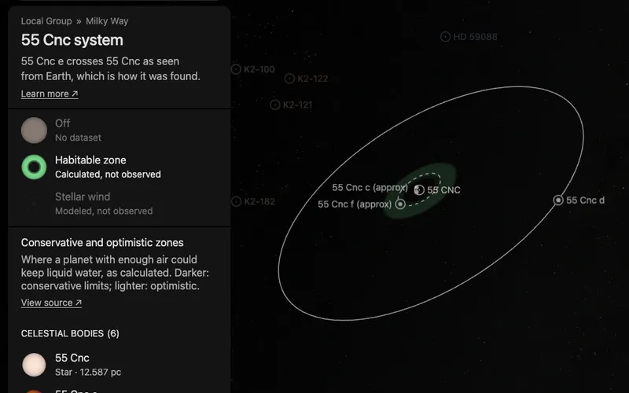

# 55 Cnc's habitable zone

A flat green band around [55 Cnc](../hd-75732/README.md), drawn in the plane of its outer planets' orbits. It is what
the star's dataset "Habitable zone" shows, a dataset of the whole system: the star's card and its system's card both
list it. It has no page of its own: it is a plane bank, one prepared picture the world lays in the system.

The band is a calculation, not an observation. It marks where a planet with enough atmosphere could keep liquid water
on its surface, by one published model. A planet inside it is not known to be habitable.

## Sources

- **The four distances.** The [Habitable Zone Gallery](https://hzgallery.org) (Kane & Gelino 2012,
  [PASP 124, 323](https://doi.org/10.1086/665271)) lists, for each planet, its star's habitable zone in au. The kept
  file, [`hd-75732.json`](source/hzgallery/hd-75732.json), holds the five rows of this system from the Gallery's
  JSON product (`https://hzgallery.org/data/hzgallery.json`, 3,938,737 bytes, last updated 2026-10-08).
- **Which row.** The Gallery calculates each planet's row from the star's parameters in that planet's reference, and the
  rows of 55 Cnc disagree. Planet e's row uses Bourrier et al. (2018)'s star, 5,172 K and 0.943 solar radii, the star the
  [star's page](../hd-75732/README.md) shows; it is the row read. The rows of b, c, d and f use 5,198 K and 0.98 solar
  radii, and put each edge about 5% farther out.
- **The method.** The Gallery calculates the distances by Kopparapu et al. (2013,
  [ApJ 765, 131](https://doi.org/10.1088/0004-637X/765/2/131); 2014,
  [ApJ 787, L29](https://doi.org/10.1088/2041-8205/787/2/L29)) from the star's temperature and luminosity: 5,172 K and
  0.571 times the Sun's luminosity in the row read, inside the 2,600 to 7,200 K the model was fitted to.
- **Terms.** The Gallery states no licence. It asks for the acknowledgement "This research has made use of the
  Habitable Zone Gallery at hzgallery.org" and a citation of Kane & Gelino (2012).

| Zone | Inner edge | Outer edge | Limits |
| --- | --- | --- | --- |
| Conservative | 0.7435 au | 1.3367 au | Runaway greenhouse to maximum greenhouse |
| Optimistic | 0.5870 au | 1.4098 au | Recent Venus to early Mars |

## Processing

[`habitable-zone.mts`](../../../packages/bake/authoring/system-planes/habitable-zone.mts) (`hd-75732-habitable-zone`) reads the recipe,
[`zone.json`](source/zone.json), and writes the descriptor, the prepared plane and its picture: the same picture, colors
and opacities as [TRAPPIST-1's](../trappist-1-habitable-zone/README.md), a presentation choice.

- **Plane.** The star's world position is the centre. The plane's normal is the mean of the orbit normals of planets b,
  c, d and f as the world draws them. Only d's tilt is measured; b, c and f are drawn in d's plane, so the four agree.

## Evidence

- **Against the orbits.** With the orbits the planet pages use, f (0.80 au) lies in the conservative zone; b (0.12 au),
  c (0.25 au) and e (0.015 au) lie inside the optimistic zone's inner edge, and d (5.58 au) outside its outer edge.
- **The plane.** The four orbit normals lie within 0.000° of the plane's normal (printed by the script).

## Known problems

- **The limits assume a planet like Earth.** They are for a planet of one Earth mass with water, and a carbon dioxide
  and nitrogen atmosphere. Planet f, the one inside the zone, is a giant: its row in the Gallery gives 0.153 Jupiter masses (about 48 Earth masses), a minimum mass.
- **The plane is d's.** Planet e's orbit is drawn at its own measured tilt to the sky, 10.3° from d's; how the orbits
  are turned about the line of sight is not measured, so the planets' nodes and the band follow the drawing convention.
- **The band has no label in the world.** The dataset's card names it; nothing is written on the band itself.

[Inputs](source/manifest.json) · [Delivered files](inventory.json)
