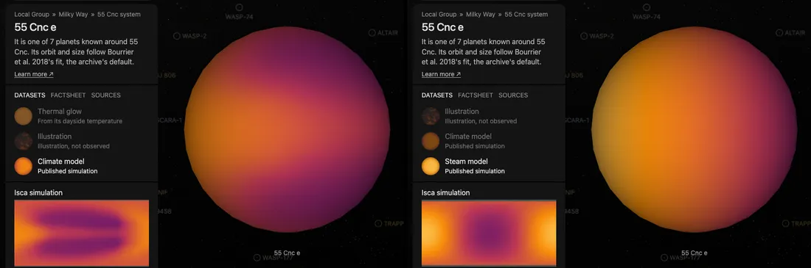

# 55 Cnc e

## Sources

It is one of 7 planets known around 55 Cnc. Its orbit and size follow Bourrier et al. 2018's fit, the archive's default. The introduction is generated from Bourrier et al. 2018's published values; the sections below are the data's own.

**Size and mass.** Radius 0.1672763 Jupiter radii from Bourrier et al. 2018 (2018A&A...619A...1B), via the NASA Exoplanet Archive (https://ui.adsabs.harvard.edu/abs/2018A&A...619A...1B/abstract): 11,958.9 km at 71,492 km per Jupiter radius. GM from the mass 0.02513923 Jupiter masses (Bourrier et al. 2018, the mass the NASA Exoplanet Archive's composite table adopts (2018A&A...619A...1B), via the NASA Exoplanet Archive, https://ui.adsabs.harvard.edu/abs/2018A&A...619A...1B/abstract) times JPL's Jupiter GM. A sphere: no oblateness is measured.

**Orbit.** Kokori et al. 2023 (2023ApJS..265....4K), via the NASA Exoplanet Archive ps table (pl_refname KOKORI_ET_AL__2023): P 0.73654625 d Bourrier et al. 2018 (2018A&A...619A...1B), via the NASA Exoplanet Archive ps table (pl_refname BOURRIER_ET_AL__2018): a/R* 3.52; Bourrier et al. 2018 (2018A&A...619A...1B), via the NASA Exoplanet Archive ps table (pl_refname BOURRIER_ET_AL__2018): inclination 83.59 degrees Bourrier et al. 2018 (2018A&A...619A...1B), via the NASA Exoplanet Archive ps table (pl_refname BOURRIER_ET_AL__2018): e 0.05 Bourrier et al. 2018 (2018A&A...619A...1B), via the NASA Exoplanet Archive ps table (pl_refname BOURRIER_ET_AL__2018): omega 86 degrees Kokori et al. 2023 (2023ApJS..265....4K), via the NASA Exoplanet Archive ps table (pl_refname KOKORI_ET_AL__2023): transit mid-time 2459370.807543 BJD, taken as BJD_TDB; with its period, the row that predicts 2026-01-01 best (1 sigma 1 min) Display convention: transit photometry does not measure the orbit's position angle on the sky, so the ascending node is set at position angle 0 (celestial north).

**Color.** A black body at the 2,360 K dayside brightness temperature measured in secondary eclipse at 4.5 µm (Demory et al. 2012, dayside brightness temperature at 4.5 µm (NASA Exoplanet Archive emission table)): #ff9e3e. Chosen from the archive's emission rows by rule: 1 measured of 3 rows; the smallest relative uncertainty, then the longest wavelength. Reflected starlight is not included.

**Illustration dataset.** The base-color texture of NASA's [55 Cnc e 3D Model](https://science.nasa.gov/resource/55-cancri-e-3d-model/), credited to NASA Visualization Technology Applications and Development (VTAD). The original GLB (`55_Cancri_e_1_24364.glb`) is declared in [the manifest](source/manifest.json). The resource page gives only a one-line description and the credit; it does not say how the texture was made. Nobody has resolved this planet's disc, so none of the color or features in it was observed. Preparation carries the texture through the model's own texture coordinates onto the sphere and does not repaint it ([`glb-base-color`](../../../packages/bake/src/objects/layers/shape-model/glb-surface.ts)); its longitudes are arbitrary. The model's texture is named `LHS3844b_assembled.jpg` inside the file: NASA reused the texture of another lava-world illustration, LHS 3844 b, for this model. It is shown as NASA published it for 55 Cancri e. It is a second dataset: Thermal glow stays the default. It is listed in the package's illustration datasets, so it never counts as imagery. NASA content is generally not subject to copyright in the United States and is credited to NASA ([NASA's terms](https://www.nasa.gov/nasa-brand-center/images-and-media/)).

**Climate model and Steam model datasets.** Two runs of the Isca general circulation model with non-grey radiative transfer, from Zhan & Koll (2026), "Reinterpreting the JWST Observations of 55 Cancri e with a Non-Grey General Circulation Model", The Astrophysical Journal ([arXiv:2606.12116](https://arxiv.org/abs/2606.12116), [doi:10.3847/1538-4357/ae8198](https://doi.org/10.3847/1538-4357/ae8198)), released under CC BY 4.0 as [Zenodo record 19388488](https://zenodo.org/records/19388488). The release is one ZIP archive of 48.6 GB. The two files read are members of its `Figure1/` folder, which holds the three runs the paper's Figure 1 draws, each a NumPy dictionary of `ts`, `t`, `u`, `v`, `lat`, `lon` and `pfull`. Each file is restored out of the archive by byte range (three requests), never with the archive.

- **Climate model** is `55cnce_1e6pa_1e0co2.npy`: a cloud-free atmosphere of pure carbon dioxide, 10 bar at the surface. The map is `t`, air temperature in kelvin, on the model's 128 × 64 grid, on level 29 of 40 (4,968 hPa), the level nearest half the surface pressure, which Figure 1(a) draws. It runs from 1,485.0 K to 2,667.5 K, 1,993.7 K on area average: 2,251.2 K over the day side and 1,736.1 K over the night side. The hottest node is 16.9° east of the point under the star.
- **Steam model** is `55cnce_1e6pa_1e0h2o.npy`: a cloud-free atmosphere of pure water vapor, 10 bar at the surface, on the coarser 64 × 32 grid the paper uses for water. The map is `t` on level 13 (49.4 hPa), the level nearest 0.005 of the surface pressure, which Figure 1(a) draws for this run because its deep air is all one temperature. It runs from 1,543.8 K to 3,045.5 K, 2,281.4 K on area average: 2,673.0 K by day and 1,889.7 K by night.

Both are drawn in false color from 500 to 3,500 K, the range of the paper's Figure 1 color bar, so the two can be compared. The paper finds that Webb's eclipse spectra of the planet (Hu et al. 2024, [arXiv:2405.04744](https://arxiv.org/abs/2405.04744)) fit thick (10 bar or more), carbon-dioxide-rich atmospheres best; it rules out thin, pure carbon monoxide and carbon-dioxide-poor ones, and calls pure water borderline. So the carbon dioxide run is the dataset the page opens on, the water run is the second, and Figure 1's thin, carbon-dioxide-poor run is not shown. The 100-bar runs that fit best are in the release only as spectra (its `Figure2/`), not as maps.

The release does not state where the star is overhead. The paper's Figure 1 puts longitude 0 at the centre, and the water run's surface temperature peaks at grid longitude 0.0 (the carbon dioxide run's at 2.8°, the next grid column east), so grid longitude 0 is the planet's longitude 0. The paper runs the planet on a circular orbit, keeping one face to its star (its Table 1). Each map is the value of its grid level as released; nothing is averaged, smoothed or extrapolated. There are no samples poleward of 87.9° (carbon dioxide) and 85.8° (water), and those caps are gray.

**Charts.** The orbits of 55 Cnc's planets from above, from their hosted-orbit records, and its transmission spectrum, 25 bins from Tsiaras et al. 2016 in the archive's transitspec table; its transit in 3 TESS sectors (44, 46, 72), folded onto its orbit. Upper limits and rows without an error are left out.

## Evidence

Generated 2026-09-24 by [new-object-cli.mts](../../../packages/telescope-cli/src/new-object/new-object-cli.mts); the orbit is the one recorded in [its astronomy record](../../../packages/astronomy/data/bodies/hd-75732e.json).

- The Illustration dataset was added by [`illustration-dataset.mts`](../../../packages/bake/cli/illustration-dataset.mts) (now [`packages/bake/cli/illustration-dataset.mts`](../../../packages/bake/cli/illustration-dataset.mts)) and baked with the package on 2026-09-24. In headless Chrome the dataset opens on the NASA art with no console errors ([the four new illustrated planets](../../../docs/images/illustrated-exoplanets-new-systems.webp)).

- The Climate model and Steam model datasets were added on 2026-10-14 by [new-object-cli.mts](../../../packages/telescope-cli/src/new-object/new-object-cli.mts) `--simulation`, which checked the record's license and that the files are named for this planet, and read each field through the [`npy-lonlat-field`](../../../packages/bake/src/objects/raster/numpy/npy-lonlat-field.ts) format. Each file came out of the 48.6 GB archive in three range requests (the water run's in 10 s). The minimum and maximum of every array the reader returns equal those of an independent read of the same files. In headless Chrome against the dev server the page opens on Climate model, both models and Thermal glow switch on click, and the console shows no error.

## Known problems

- **Model maps.** The Climate model and Steam model datasets are cloud-free model runs, not measurements, and two scenarios of many. The paper cites Webb observations in which the planet's brightness temperature at 4.5 µm changes by at least a factor of three within a week (Patel et al. 2024), and finds the weather in its runs far too weak to explain that.
- **The release's pressure unit.** The release's README gives `pfull` in Pa, but its values (7.4 to 9,824 in a 10-bar run) are hectopascals. The level is chosen by its index, so no value read depends on the unit; the pressures quoted here are in hPa.
- **One level, not one pressure.** Each map is the model level nearest the pressure the paper draws (4,968 hPa for 5,000; 49.4 hPa for 50), not a value interpolated to that pressure.
- **Orbit convention.** omega 86 degrees is taken as Bourrier et al. 2018 gives it through the archive (pl_orblper); papers differ on whether that is the star's or the planet's argument of periastron. The epoch is the transit, so a swapped convention would only mirror the ellipse (e 0.05) about the line of sight.
- **Quoted text.** The introduction quotes sentences of the Wikipedia article "55 Cancri Ae" (revision 1374105089) verbatim, CC BY-SA 4.0.
- **The Illustration dataset is art, not data.** Its colors and features are the artist's, and its longitudes are arbitrary; it is shown as NASA published it, with no color corrected.

[Investigation ledger](investigations.json) · [Inputs](source/manifest.json) · [Preparation](source/preparation) · [Delivered files](inventory.json) · [Credits](NOTICE.md)
