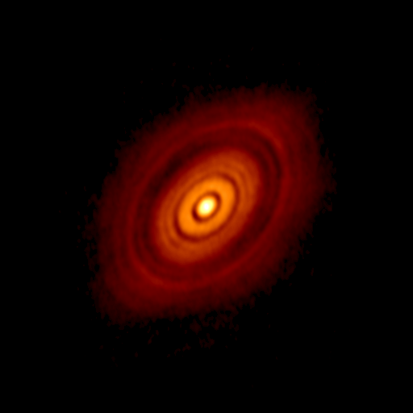
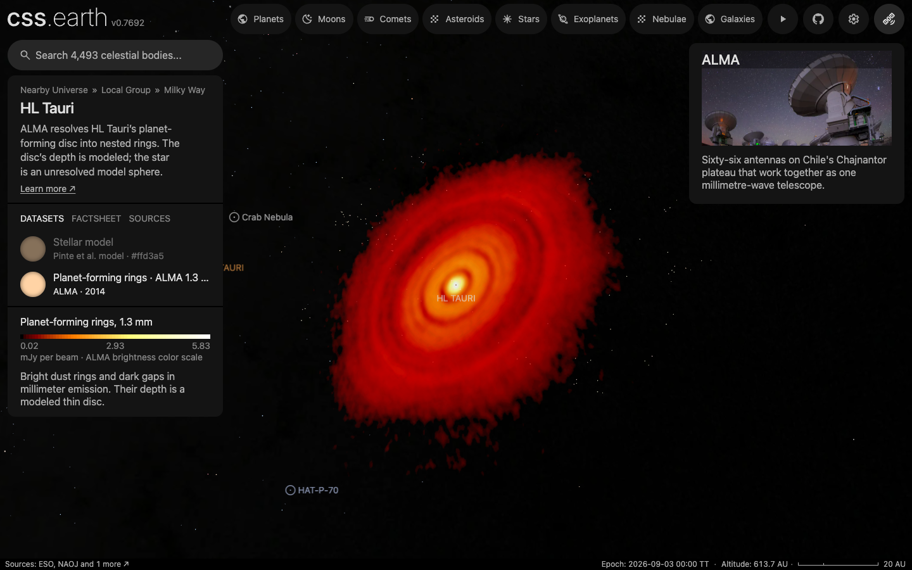
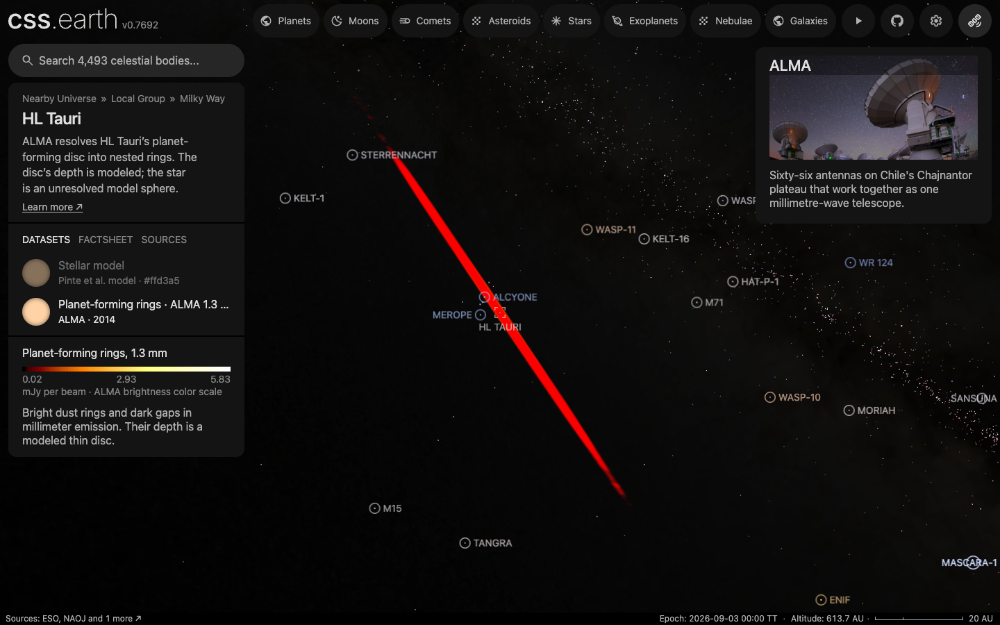

# HL Tauri’s planet-forming disc

This package draws the nested bright rings and dark gaps of [HL Tauri](../hl-tauri/README.md) in their own emission at 1.3 millimeters. The native ALMA image supplies every sky column’s brightness and structure. A published inclined plane and a thin vertical profile place those columns in three dimensions. The prepared XYZ volume uses the existing star-attached disc renderer.

## Sources

| Input | Meaning and selection |
| --- | --- |
| [HL Tau Band 6 Science Verification](https://almascience.nrao.edu/almadata/sciver/HLTauBand6/) | The unchanged `HLTau_B6cont_mscale_ap.image.fits` member of `HLTau_Band6_ReferenceImages.tgz`, project 2011.0.00015.SV. This CASA 4.2.2 reference image is the product used by the published analysis. |
| [ALMA Partnership et al. (2015), ApJL 808, L3](https://doi.org/10.1088/2041-8205/808/1/L3) | Table 1 gives the continuum peak and image properties; Section 3.1.3 gives the common plane measured from eight rings: inclination 46.72 ± 0.05°, position angle 138.02 ± 0.07°. Table 2 supplies the reference B5 radius, 68.8 au. |
| [Pinte et al. (2016), ApJ 816, 25](https://doi.org/10.3847/0004-637X/816/1/25) | The millimeter dust is strongly settled, with a scale height near 1 au at 100 au. The drawn height is a constant 1 au Gaussian approximation to that result. The gas’s 10 au height is not used for the millimeter dust. |

The image was observed in October and November 2014; its `DATE-OBS` is 2014-10-24T06:58:24.288000. It has 1600 × 1600 pixels, 5 mas per pixel, and a 35.06 × 21.81 mas restoring beam at 11.0°. Values are Jy per beam, not visible color. The release notes require the acknowledgement in [NOTICE.md](NOTICE.md); they specify no Creative Commons identifier.

The [recipe](source/circumstellar.json) fixes these inputs and the display choices. One volume unit is one astronomical unit at the adopted 140 pc. The star’s radio position is propagated to the image’s observing time before the image is sampled through its own SIN world coordinates. The background is subtracted once, and the noise is measured in an empty annulus 1.5″ to 2.5″ from the star. No central mask removes the observed inner dust emission.

## Evidence

- **Native image:** peak 6.483 mJy per beam, against the paper’s 6.48 ± 0.03. Noise measured here is 11.03 µJy per beam, against its 11. The propagated star is at native pixel `(802.454, 839.061)`; the brightest native pixel is `(802, 839)`.
- **Spatial prior:** the measured-profile disc projects to the image with an RMS residual of 49.3 µJy per beam. A single Gaussian belt leaves 311, a spherical shell 223, and constant depth 349. These comparisons use the same image samples and 128 line-of-sight samples; they select a spatial approximation, not a measured third axis.
- **Brightness colors:** the underlying vector bar in Figure 2(b) supplies 256 colors. Its nine printed flux ticks calibrate a power display of about 0.55. Seven ticks fit the curve; the withheld 0.6 and 3.0 mJy-per-beam ticks differ by 0.012 and 0.004 µJy per beam. The worst error over all nine is 0.026 µJy per beam. Tick strokes are excluded from the colors, avoiding false black bands.
- **Prepared field:** 512 cells sample the sky image across 360 au, at 0.703 au per cell, close to the native 0.7 au pixel spacing. The unencoded observation columns are placed directly in a 1024 × 1024 × 35 grid aligned with the published disc plane, at 0.352 au planar spacing, retaining six Gaussian scale heights on either side. Its 60 X, 60 Y and 35 Z slabs use 1024-pixel textures. There is no encoded cubic field to rotate and resample between the observation and this grid. Every color channel shares one normalized depth profile. Runtime receives the baked textures, not FITS data or a geometry recipe.

The [source preview](source/previews/dust.png) shows the sampled observation in the calibrated brightness colors, north up and east left:

The browser renders the disc as retained 3D slabs. These full-page Chrome captures show the observed inclination and an almost edge-on view, at the same camera distance:

The native-detail bake passes its pixel-contrast and physical-orientation checks. A cache-free replay reproduces all 34 prepared files byte for byte. The browser keeps the same 450 resident bank nodes during the three inspected camera poses, below the 500-element budget. These checks establish preparation and retained rendering, not a frame-rate measurement.

## Known problems

The observation has two spatial axes. Depth is a thin-disc prior on the published plane, and a constant 1 au height simplifies Pinte et al.’s grain-dependent settling model. Southwest is drawn nearer as a stated tilt-sign convention; this continuum image alone cannot determine the nearer side.

The colors represent millimeter brightness. Volume opacity and the browser’s eight-bit compositing are display approximations, so the scene is not a quantitative dust-mass or radiative-transfer model. Nothing finer than the restoring beam or prepared sampling is claimed. Dark gaps retain the emission the image measures, rather than becoming invented empty holes.

The published color-bar caption says −2 rms at its low end, but the actual vector bar and printed tick positions reproduce +2 rms. The calibration follows those nine ticks, giving 0.022 to 5.832 mJy per beam; its measurements and fitted curve are preserved in the [color-map record](source/alma-2015-figure-2-colormap.json).

Preparation and reproduction

`node packages/telescope-cli/authoring/hl-tauri/restore.mts` restores the unchanged native FITS member from the source cache, falling back to the public release bundle and extracting only its declared member. It checks the native image identity, dimensions, units and byte count. `--output=<path>` exercises restoration at an empty path without replacing the working input.

`node packages/telescope-cli/authoring/hl-tauri/color-map.mts --check` reproduces the palette from the retained vector colors and flux ticks. `node packages/telescope-cli/authoring/circumstellar/author.mts hl-tauri-disc --check` recomputes the source field and records without replacing them. `node packages/bake/cli/prepare-nebulae.mts --object=hl-tauri-disc` bakes that field into the application’s existing volume bank.

The eight-ring fit fixes the common plane; B5’s radius scales the height convention, not the full disc extent. The native image’s deprojected radial profile weights each line of sight on that plane, while the image itself supplies each displayed column. This preserves the observed offsets and asymmetries in the reference view. A single Gaussian belt is only a diagnostic baseline and may reach its search boundary; the accepted profile still has to beat that baseline, a spherical shell and constant depth.

The aligned grid carries its rotation in the existing prepared physical frame. Its 1 au height is preserved; no thickness is added to hide sampling defects. Its column integrals set the intended opacity before eight-bit encoding and slab compositing, which remain display approximations. The offline arrival photograph includes the selected hosted bank and frames its extent, so the disc is visible on arrival as well as after opening its dataset.

The display fades all channels together from one to two times the measured noise and tapers from where the radial median reaches that noise, 140 au. The top of the brightness display reaches alpha 0.95, an explicit display choice. No planets, jets or surrounding cloud are inferred from this image.

[Investigation ledger](investigations.json) · [Inputs](source/manifest.json) · [Recipe](source/circumstellar.json) · [Processing records](source/provenance.json) · [Credits](NOTICE.md)
