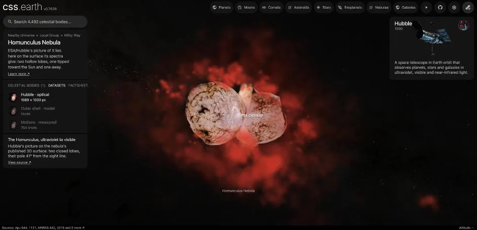
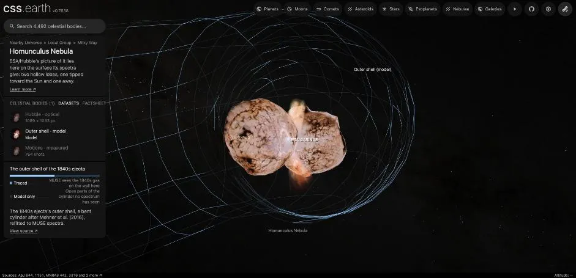
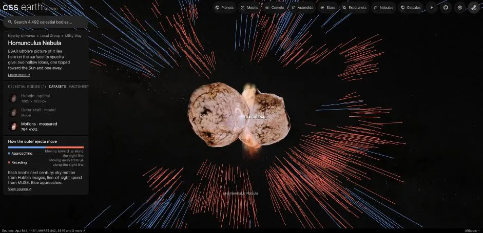

# Homunculus Nebula

ESA/Hubble's picture of the Homunculus, the two-lobed cloud of dust around the star Eta Carinae, on the surface its spectra give. **The surface is the model Steffen et al. (2014) made from spectra of the whole nebula, as NASA publishes it; its tilt and direction are Smith's (2006). How the model's file lies on the picture is not published: it is measured here.**

The page has three datasets, and each draws the lobes:

- **Hubble · optical** (the default): the picture on the lobes, and the red gas and dark dust around them as dots. **The gas cloud is derived here: neither observed in 3D nor published.** Its places come from knots measured on Hubble and MUSE data, its light from Hubble pictures.
- **Outer shell · model:** the outer shell of the 1840s ejecta as the bent cylinder of Mehner et al. (2016). **Their fitted shape is not released: the cylinder is refitted here to MUSE H-beta.**
- **Motions · measured:** 764 knots, each an arrow of its motion over 100 years. The sky motions are measured here on Hubble F658N images, the line-of-sight speeds on the MUSE cube.

## Sources

| Selected source | Input and meaning |
| --- | --- |
| [ESA/Hubble potw1208a](https://esahubble.org/images/potw1208a/) | [Record](../../sources/esahubble-potw1208a.json). Preview of a forthcoming supernova: ACS at 220, 250, 330, 550 and 660 nm; 1089 × 1033 px over 27.0 × 25.6 arcsec (`source/source.jpg`, the publisher's JPEG, restored from its origin). Credit: ESA/Hubble & NASA. A display composite, not calibrated photometry. |
| [Steffen et al. (2014)](https://arxiv.org/abs/1407.4096) | [Record](../../sources/publication-steffen-2014-homunculus-3d.json). The first full 3D model of the Homunculus, from VLT/X-shooter H2 2.12 µm spectra that map the whole nebula: one continuous surface for each lobe, with its polar holes, trenches and protrusions. The optical picture is the star's light scattered by the dust of that thin, clumpy shell. |
| [NASA 3D Resources, Eta Carinae Homunculus Nebula](https://github.com/nasa/NASA-3D-Resources/tree/master/3D%20Printing/Eta%20Carinae%20Homunculus%20Nebula) | [Record](../../sources/nasa-3d-homunculus-nebula.json). That model as a file for printing: a binary STL of 17,101 triangles (`source/homunculus.stl`, restored from its origin), the nebula's pole along the file's z axis. Free and without copyright. |
| [Smith (2006)](https://arxiv.org/abs/astro-ph/0602464) | [Record](../../sources/publication-smith-2006-homunculus-shape.json). The pole: an inclination of 41.0 ± 0.5°, the tilt of the polar axis out of the line of sight, along position angle 310°. The distance: 2,350 ± 50 pc. |
| [HST ACS/HRC F220W and F550M, GO 9973](https://mast.stsci.edu/search/ui/#/hst/results?proposal_id=9973) | [Record](../../sources/mast-hst-go9973-eta-carinae-acs-hrc.json). The ultraviolet and visible exposures of 2003 the picture was made from, as drizzled FITS. Dust absorbs the ultraviolet most, so F220W shows the dust lanes deepest; it also sees the lobes' cells up to the star, where the picture is the star's glare. Downloaded to the generator; not tracked. |
| [HST WFC3/UVIS F280N, GO 15289](https://mast.stsci.edu/search/ui/#/hst/results?proposal_id=15289) | [Record](../../sources/mast-hst-go15289-eta-carinae-f280n.json). Mg II 2800 Å, 2018: the lobes' detail beside the star where the picture is glare. Its saturated pixels about the star are left out. Downloaded to the generator; not tracked. |
| [Frangi et al. (1998)](https://doi.org/10.1007/BFb0056195) | [Record](../../sources/publication-frangi-1998-vesselness.json). The line detector the dust lanes are found with. |
| [ESA/Hubble heic1912a](https://esahubble.org/images/heic1912a/) | [Record](../../sources/esahubble-heic1912a.json). Cosmic Fireworks in Ultraviolet, released 1 July 2019: WFC3 Mg II 280 nm, 336 nm and [N II] 658 nm; 1779 × 1805 px, north up. Its red channel lights the gas dots. Its scale, 0.02294″ per pixel, and the star's pixel are fitted here against the 2014 F658N image (correlation 0.68). Credit: NASA, ESA, N. Smith, J. Morse. Downloaded to the generator; not tracked. |
| [HST F658N, ACS/WFC and WFC3/UVIS, 2005 to 2020](https://mast.stsci.edu/search/ui/#/hst/results?proposal_id=13390) | [Record](../../sources/mast-hst-eta-carinae-f658n-acs-wfc3.json). [N II] images from programmes 10241 (2005), 13390 (2014), 15596 (2018) and 15823 (2020), drizzled. The 2014 image is the reference the motions are measured against. Downloaded to the generator; not tracked. |
| [HST F658N, WFPC2, 1993 to 2008](https://mast.stsci.edu/search/ui/#/hst/results?proposal_id=9775) | [Record](../../sources/mast-hst-eta-carinae-f658n-wfpc2.json). Seven [N II] visit mosaics, 1993 to 2008. They lengthen the motions' time span; the 2003 visit also lights the gas beyond heic1912a's field. Downloaded to the generator; not tracked. |
| [ESO VLT/MUSE cube ADP.2016-06-20T21:41:31.322](https://dataportal.eso.org/dataPortal/file/ADP.2016-06-20T21:41:31.322) | [Record](../../sources/eso-adp-2016-06-20t21-41-31-322.json). Programme 094.D-0215(A), observed 12 December 2014: 0.2″ spaxels, 1.25 Å channels. Its H-beta channels give the line-of-sight speeds. About 17.9 GB; downloaded to the generator, not tracked. |
| [Mehner et al. (2016)](https://arxiv.org/abs/1610.01688) | [Record](../../sources/publication-mehner-2016-homunculus-outer-ejecta.json). A&A 595, A120. MUSE spectra of the outer ejecta and a SHAPE model of the 1840s material outside the Homunculus as a bent, tube-like shell along its axis. They see only parts of the cylinder. The model fits brightness, not density. |
| [Kiminki et al. (2016)](https://arxiv.org/abs/1609.00362) | [Record](../../sources/publication-kiminki-2016-eta-carinae-proper-motions.json). MNRAS, doi [10.1093/mnras/stw2019](https://doi.org/10.1093/mnras/stw2019). Proper motions of the outer ejecta on Hubble [N II] images over about two decades, measured within each instrument. The method the motions here follow. |
| [SIMBAD, eta Car](https://simbad.cds.unistra.fr/simbad/sim-id?Ident=eta+Car) | [Record](../../sources/simbad-eta-carinae.json). The star's place, from UCAC4. |

## The picture

- **Registration:** the file's embedded sky tags give scale and direction, 0.0248″ per pixel and north 34.98° left of vertical. The star gives the place: the middle of the picture's saturated pixels is set at Eta Carinae's catalogued place.
- **The surface on the sky:** the pole is Smith's: 41° from the sight line toward position angle 310°, the south-east lobe approaching. The file says nothing of its unit, its turn about the pole, the star's place in it or which end recedes. [model-fit.mts](../../../packages/bake/authoring/homunculus-nebula/model-fit.mts) lays the model's outline on the picture for every choice and keeps the one that shares the most with the picture's lit pixels: the +z end recedes, the file is turned 328° about the pole, a unit is 2.72″ and the star is at (0.96, 0, −0.08) of the file. The outline then shares 86.8% with the lit pixels.
- **A check against a printed number:** the file's farthest point along its pole is 3.89 units from the star, 10.6″, which is 3.72 × 10¹⁵ m at 2,350 pc. Steffen et al. state the lobes' speeds at 3.4 × 10¹⁵ m.
- **The surface:** the model's own triangles, its holes closed and simplified to 1,200, each drawn as one leaf with the picture painted on it ([surface-mesh.ts](../../../packages/bake/src/image-layers/surface-mesh.ts)). The lobes are a closed shell seen from every side. Its outline is fitted to the picture's lobe edge direction by direction about the star, by at most 15% (`edgeFit`).
- **The faces the picture shows:** a face that turns toward the Sun, is the nearest crossing of its sight line and lies on the picture's lobe light takes the picture there, sharp. The far lobe is seen through the red equatorial skirt: its own dust pattern is kept, raised to the near lobe's brightness, and given the near lobe's color.
- **Color:** the near lobe's, as a ramp from its brightest cells to its darkest lanes, read from the picture's pixels on that lobe away from the star. A face keeps its own color where nothing darkens it; where a lane or patch does, its color slides along the ramp: dark orange, brown, black.
- **Dark lanes and patches:** the lanes are a map the [generator](../../../packages/bake/authoring/homunculus-nebula/filament-map.mts) builds from the picture and F220W and F550M, each registered on the picture by its lobes' detail: dark lines found at four widths (Frangi et al. 1998) and weighted with settings chosen on the Nebula Lab's filament tuner (`source/filaments.png`). The patches are where the picture's light falls well below the light around it. Both darken a face, never brighten it.
- **The star's glare:** within 2.9″ of the star the picture is the star's light. There the faces take the lobe light carried in from around the glare with F220W's and F280N's own detail (`source/detail.png`, from the same generator), so the cells run up to the star.
- **The faces the picture does not show:** the flanks seen edge-on, the far sides and the faces behind the other lobe. Each lobe is unwrapped on a Mercator chart about the sight line, which keeps shapes; the cells the picture shows are known, and the others are filled block by block from the known ones of both lobes (image quilting, Efros and Freeman 2001), each block the one that best matches what is filled around it, copied at its latitude's scale. The seams are relaxed (Poisson blending, Pérez et al. 2003), the fill takes the known cells' distribution of brightness, and the two lobes' fills blend across the waist. A presentation choice: it shows what the lobes look like where they are seen, not what is there.
- **Opacity:** the dark dust is solid; a face grows clear as it brightens, to 55% at the brightest, so the far wall and the star show through the glowing parts. A presentation choice.
- **The equatorial skirt:** a thin, ragged disc in the plane through the star across the pole (Smith 2009; Davidson et al. 2001 find it thin and planar). Its two fans, north-east and west of the star, are regions drawn by hand on the picture (`source/regions.json`), over the lobes too: inside them the picture's light lies on the skirt, and the lobe beneath is filled as an unseen face is. The skirt is five sheets fanning 6° either side of the plane, a thickness the papers do not measure: modeled. The model's equatorial protrusions under the fans are brought back to the lobes' smooth shape. Between ACS/HRC F550M (2003) and WFC3/UVIS F658N (2018) the fans' features move straight out from the star, within about 10°, at 15 to 45 milliarcseconds a year.
- **The star:** a glow inside the shell on three crossed squares: a core of 0.15″ and a halo of 0.6″, faded out by 2.5″. Presentation: the picture's star is saturated.
- **Drawing:** each triangle is a scene of its own and the renderer paints them farthest from the camera first, so the shell reads right from every side.
- **Size:** 27.0 × 25.6 arcsec, 0.31 pc wide at 2,350 pc; the lobes reach 10.6″ from the star along their pole.
- **Far view:** from afar, while another body is selected, the bank is one image on a plane fixed in its frame, drawn as the Milky Way's backing is. [`prepare-galaxy-backing.mts`](../../../packages/bake/cli/prepare-galaxy-backing.mts) reads the [backing recipe](source/backing/recipe.json) and composites the bank's triangles as seen from the Sun onto the picture's plane through the frame's centre. The plane therefore lies where the layered model's picture plane does, and turns and foreshortens as the model does. After a rebake of the bank, run `node packages/bake/cli/prepare-galaxy-backing.mts src/objects/homunculus-nebula-layers backing` again.

## The outer ejecta, measured

The three new datasets rest on one chain, [outer-ejecta.mts](../../../packages/bake/authoring/homunculus-nebula/outer-ejecta.mts), which writes three tracked records: [kinematics.json](source/kinematics.json), [tube.json](source/tube.json) and [cloud-points.json](source/cloud-points.json). Its stages:

1. **Hubble images on one grid:** the eleven F658N epochs, 1993 to 2020, are put on a common sky grid. The WFPC2 visits are tied to the 2005 ACS epoch by 21 to 43 field stars each, with 4.5 to 7.4 mas scatter.
2. **Artefacts:** each epoch's diffraction spikes, bleed trails, field stars, uncovered pixels and the star's own 9″ are masked, and the masked pixels set to zero.
3. **Sky motions:** each 2.4″ tile of the 2014 image, between 9.5″ and 57″ from the star, is found again in every other epoch by normalized cross-correlation. A straight line of position against time gives its motion. A tile needs four epochs over ten years: 1,946 of 2,715 tiles qualify. After Kiminki et al. (2016); see the known problems for how it differs from their method.
4. **Line-of-sight speeds:** a tile counts when its motion is measured to within 6 mas a year and points away from the star (cosine above 0.85). Its MUSE H-beta spectrum, less the ring around it and the Carina Nebula's own line, gives its speed: the strongest peak between 230 and 3,200 km/s. 891 of 1,103 such tiles have one.
5. **Depth:** a knot moving straight out from the star lies as far behind or in front of the star, over its distance on the sky, as its line-of-sight speed over its sky speed: depth = ρ · v<sub>los</sub> / v<sub>tan</sub>. Sky speeds are at 2.3 kpc. No ejection date is assumed.

[knots.mts](../../../packages/bake/authoring/homunculus-nebula/outer-ejecta/knots.mts), [hubble-motions.mts](../../../packages/bake/authoring/homunculus-nebula/outer-ejecta/hubble-motions.mts) and [hubble-masks.mts](../../../packages/bake/authoring/homunculus-nebula/outer-ejecta/hubble-masks.mts) hold every constant.

## Hubble · optical: the gas cloud



The red gas and dark dust around the lobes are 7,358 dots in [cloud-points.json](source/cloud-points.json), each with a place, a diameter, a color and an opacity. **The cloud is derived by this repository from the measurements above and two pictures. It is not an observation of the gas in 3D, and no paper publishes it.** [cloud-points.mts](../../../packages/bake/authoring/homunculus-nebula/outer-ejecta/cloud-points.mts) builds it:

- **Places:** the 762 knots within 45″ of the star's sky plane. A sky cell of 0.6″ takes its dots' depths from its six nearest knots, with 1″ of scatter. Each depth is also mirrored to the far side of the star: the ejecta are taken as symmetric front to back. This is an assumption: the far side is filled, and the Earth view is unchanged.
- **Light:** the [N II] light where Earth sees the cell. Inside heic1912a's field it is heic1912a's red channel. Beyond it, the 2003 WFPC2 F658N mosaic, scaled by 3.42 to heic1912a: the median ratio on the 412 knots both images see. On the lobes the dots carry no light: the lobes' light is their own.
- **Dust:** 638 dots are dark dust. They lie where the optical picture is darker than the gas around it, more than 2″ from the lobes, at a knot's depth.
- **The lobes' occluder:** two ellipsoids, one for each lobe of Steffen et al.'s mesh as the recipe places it. A dot behind them is dimmed to 15% of its opacity at an ellipsoid's middle.
- **Drawing:** [prepare-cloud-points.mts](../../../packages/bake/cli/prepare-cloud-points.mts) groups the dots into 300 clusters of about 25 (k-means). Each cluster is drawn once, as Earth sees it, into a 96 px cell of `prepared/cloud-atlas.webp` through the lossy lane. `prepared/cloud.bin` ([cssearth-cloud-points@1](../../../packages/objects/src/prepared-data/cloud/cloud-points.ts)) holds each cluster's centre, width, cell and the occluder. The [renderer](../../../packages/renderer/src/universe/cloud-points.ts) places each cluster as a billboard facing the camera and dims it by how deep its sight line passes through the occluder. While the camera moves, only each billboard's transform and opacity change; their order, far to near, is set once the camera rests.

## Outer shell · model



Mehner et al. (2016) model the 1840s material outside the Homunculus as a bent, partial cylinder along its axis. Their SHAPE model is not released as data. So [tube.mts](../../../packages/bake/authoring/homunculus-nebula/outer-ejecta/tube.mts) refits that shape to the MUSE H-beta emission:

- **Points:** 98,787 MUSE detections; 34,384 move faster than 450 km/s along the sight line; 17,097 remain after those near Hubble tiles dated before 1780 are dropped. A detection's depth is its speed times the 172 years since 1843, at 2.3 kpc.
- **Fit:** a centreline along a position angle and a tilt from the sight line, bent toward one side, and a radius that grows from the near end to the far end. Bounded least squares with a soft L1 loss, from 12 starts. Only detections pull on the wall: the unseen parts cost nothing.
- **Result:** position angle 322.7°, tilt 26.6° from the sight line, radius 11.5″ at the near end and 16.7″ at the far end. 68% of the detections lie within 3″ of the wall. [tube.json](source/tube.json) keeps the centreline and radius from −45″ to 45″, the parameters and the 1,721 traced cells.
- **Drawing:** a wireframe of 16 rings and 12 lines along the wall, 744 segments (`prepared/outer-shell.bin`, cssearth-cloud-segments@1). The 216 segments within 3″ of a MUSE detection are solid, **Traced**. The others are faint, **Model only**: Mehner et al. (Fig. 4) say the open parts of the cylinder are not seen in the MUSE data. The label reads "Outer shell (model)".

## Motions · measured



764 arrows (`prepared/motions.bin`), one for each knot of [kinematics.json](source/kinematics.json) placed within 60″ of the star's sky plane, 764 of 891. Each runs from the knot to where its motion takes it in 100 years at 2.3 kpc. The sky velocity is the measured motion of the knot's tile; the line-of-sight speed is MUSE's. Blue approaches, red recedes. The knots placed farther out are left out: their line-of-sight speed is too large for their sky motion to be the same material's. [cloud-segments.ts](../../../packages/renderer/src/universe/cloud-segments.ts) draws the lines, dimmed behind the lobes' occluder.

## Rebuilding

The lane and detail maps are built from the downloaded HST products, then the bank is baked and its far view composited:

```
node packages/bake/authoring/homunculus-nebula/filament-map.mts src/objects/homunculus-nebula-layers <directory of the FITS files>
node packages/bake/cli/prepare-image-layers.mts src/objects/homunculus-nebula-layers
node packages/bake/cli/prepare-galaxy-backing.mts src/objects/homunculus-nebula-layers backing
```

Without the downloads, `filaments.png` and `detail.png` are restored from the source cache once published there.

The outer ejecta's records are rebuilt from the archive, then baked into the three overlay banks:

```
node packages/bake/authoring/homunculus-nebula/outer-ejecta.mts --fetch --write-source
node packages/bake/cli/prepare-cloud-points.mts src/objects/homunculus-nebula-layers
```

`--fetch` downloads the missing inputs into the body's `.local/` (URLs and sizes in [inputs.mts](../../../packages/bake/authoring/homunculus-nebula/outer-ejecta/inputs.mts)). The chain's work files go to `output/homunculus-outer-ejecta/`; `--stages=` runs some stages alone. Without `--write-source` the tracked records are left as they are.

## Evidence

The three screenshots above: the site's dev server in desktop Chrome on 2026-10-11, the default arrival camera, scaled to 941 × 455 px.

**The chain from the archives.** [outer-ejecta.mts](../../../packages/bake/authoring/homunculus-nebula/outer-ejecta.mts) was run from the archive downloads on 2026-10-11 and wrote the three source records shipped here: 891 knots, the tube and 7,358 dots. Rebaking from those records reproduces every prepared file byte for byte. Sky motions are matched in double precision: in the masked areas, which are zero, single-precision rounding can make a false match (a tile in 2020 scored 0.925 across a 49 px jump, where the true best is 0.496, below the 0.50 threshold).

**Tests.** [chain.test.mts](../../../packages/bake/authoring/homunculus-nebula/outer-ejecta/chain.test.mts) and the other tests beside it check the chain's numerical parts against NumPy, SciPy and Astropy values: a knot moving straight out gets depth over distance equal to v<sub>los</sub> / v<sub>tan</sub>, only clean outward tiles count, and a point on a straight tube's wall has no residual. [cloud-points.test.ts](../../../packages/objects/src/prepared-data/cloud/cloud-points.test.ts) and [cloud-segments.test.ts](../../../packages/objects/src/prepared-data/cloud/cloud-segments.test.ts) carry each bank through a file and back and refuse a malformed one. 61 of 61 pass (2026-10-11).

**Speed.** On an iPad (9th generation), scripted three-second rotation drags (2026-10-11): the page with the cloud's billboards ran at 26 to 53 frames a second, the lobes alone at 39 to 47, and Uranus at 38 to 43. Rejected ways of drawing the cloud are in the [investigation ledger](investigations.json).

The bake's tests ([surface-mesh.test.ts](../../../packages/bake/src/image-layers/surface-mesh.test.ts), [filaments.test.ts](../../../packages/bake/src/image-layers/filaments.test.ts)) close a surface with a hole so that every edge is held by two triangles, fill a hole in a field from its rim, draw a closed ball as triangles each opaque inside itself and clear past its long side, find a dark line as a filament and a dark spot of the same depth as far less of one, and read the recipe's closed mesh and maps and refuse what they cannot. The renderer's test paints the run nearest the camera last, and turns the order round from behind.

## Known problems

The lobes:

- The faces the picture does not show are filled with the pattern of the faces it does: plausible dust, not what is there.
- The far lobe's own pattern is seen through the skirt; its color is the near lobe's, by assumption.
- Within 2.9″ of the star the detail is the ultraviolet bands', and its brightness the light carried in from around the glare.
- The model's unit, turn and star are measured on this picture, not published. A model made from 2012 spectra is laid on a picture made from earlier exposures; the nebula expands.
- The skirt's fans are drawn by hand and its thickness is modeled.
- Each triangle is its own scene: the bank comes in two scenes a frame, which takes a few seconds.
- Colors are the publisher's display composite, not a measurement.

The outer ejecta:

- **Depth assumes radial motion.** depth = ρ · v<sub>los</sub> / v<sub>tan</sub> holds only for material moving straight out from the star. The selection lets in motion up to 32° off radial (cosine 0.85). The ratio grows errors where the sky speed is small: 127 of the 891 knots lie more than 60″ from the sky plane, from −1,207″ to +3,352″. The arrows leave those out, and the cloud uses knots within 45″.
- **Which spectrum belongs to which knot is not checked.** Each tile takes the strongest H-beta peak in a 1.2″ aperture; 450 of the 891 have more than one peak. No uncertainty is carried into the depths.
- **Cross-instrument motions.** The tracker matches every epoch against the 2014 ACS image. Kiminki et al. (2016, Sect. 2.2) measure only within one instrument: WFPC2's F658N passes −615 to +1,130 km/s of [N II], ACS's up to ±1,600 km/s and much Hα, so a knot's shape can differ between them.
- **Masked pixels are zero during matching.** A match is refused when more than 30% of its search is masked, but the matching does not ignore masked pixels. Reflection ghosts have no mask of their own, and everything within 9″ of the star is masked.
- **Dates are not used, except once.** The record's `year`, ρ / μ with no slowing down, is unreliable: 645 of 891 knots date before 1780, and 71 before the year 0. The page shows no dates. The tube fit still drops detections near tiles dated before 1780.
- **The tube's tilt sits near its bound.** The fit allows 25° to 60°; it found 26.6°. The bound, not the data, may set it.
- **The tube is a refit, not Mehner et al.'s model,** and their model fits brightness, not density. Only 216 of 744 segments are traced.
- **The cloud is derived.** Its far side is a mirror of the measured near side, by assumption. No knot lies within 10.1″ of the star, so the gas in front of the lobes takes its depth from knots outside it. Its brightness is [N II] light, not gas or dust mass; the dark dots are where the picture is darker, not a measured dust column.
- **Two distances.** The outer ejecta are measured at 2.3 kpc; the lobes are placed at 2,350 pc. Depths in arcseconds are unaffected; speeds and the 100-year arrows differ by 2%.
- A cluster of dots is drawn as Earth sees it: turned far from the Earth view, its dots keep their Earth-view pattern.
- VLT/MUSE is not in the facility catalogue: the records name it as unresolved.
