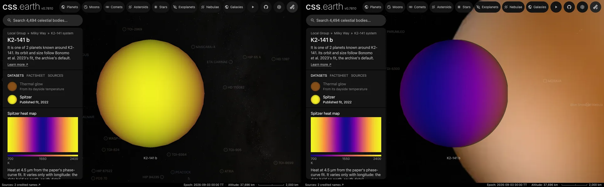

# K2-141 b

## Sources

It is one of 2 planets known around K2-141. Its orbit and size follow Bonomo et al. 2023's fit, the archive's default. The introduction is generated from Bonomo et al. 2023's published values; the sections below are the data's own.

**Size and mass.** Radius 0.13471341 Jupiter radii from Bonomo et al. 2023 (2023A&A...677A..33B), via the NASA Exoplanet Archive (https://ui.adsabs.harvard.edu/abs/2023A&A...677A..33B/abstract): 9,630.9 km at 71,492 km per Jupiter radius. GM from the mass 0.01563737 Jupiter masses (Bonomo et al. 2023, the mass the NASA Exoplanet Archive's composite table adopts (2023A&A...677A..33B), via the NASA Exoplanet Archive, https://ui.adsabs.harvard.edu/abs/2023A&A...677A..33B/abstract) times JPL's Jupiter GM. A sphere: no oblateness is measured.

**Orbit.** ExoFOP, via the NASA Exoplanet Archive ps table (pl_refname EXOFOP): P 0.2803246 d Bonomo et al. 2023 (2023A&A...677A..33B), via the NASA Exoplanet Archive ps table (pl_refname BONOMO_ET_AL_2023): a/R* derived from its semi-major axis 0.00747 au and stellar radius 0.681 solar radii; Bonomo et al. 2023 (2023A&A...677A..33B), via the NASA Exoplanet Archive ps table (pl_refname BONOMO_ET_AL_2023): inclination 86.3 degrees Bonomo et al. 2023 (2023A&A...677A..33B), via the NASA Exoplanet Archive ps table (pl_refname BONOMO_ET_AL_2023): e 0 ExoFOP, via the NASA Exoplanet Archive ps table (pl_refname EXOFOP): transit mid-time 2460232.513071 BJD, taken as BJD_TDB; with its period, the row that predicts 2026-01-01 best (1 sigma 1 min) Display convention: transit photometry does not measure the orbit's position angle on the sky, so the ascending node is set at position angle 0 (celestial north).

**Color.** A black body at the 2,049 K dayside brightness temperature measured in secondary eclipse at 4.5 µm (Zieba et al. 2022, dayside temperature of the joint fit to the Spitzer 4.5 µm and K2 phase curves, 2049 +362 -359 K): #ff8e1d. Read from the paper (abstract): the paper's two-temperature model with reflected light fitted beside the heat; the larger of its two errors is kept. Reflected starlight is not included.

**Spitzer dataset.** Brightness temperature at 4.5 µm from Zieba et al. (2022), "K2 and Spitzer phase curves of the rocky ultra-short-period planet K2-141 b hint at a tenuous rock vapor atmosphere", Astronomy & Astrophysics 664, A79 ([arXiv:2203.00370](https://arxiv.org/abs/2203.00370), [doi:10.1051/0004-6361/202142912](https://doi.org/10.1051/0004-6361/202142912)): 65 hours of Spitzer IRAC photometry over 10 orbits, 9 to 11 October 2018 (program 14135). [The record](source/science/zieba-2022/phase-curve.json) keeps each value with its place in the paper's table of models fitted to the Spitzer data alone. Of the three, the BIC prefers a sinusoid with no offset (ΔBIC 8.8 over a free offset, 9.6 over two temperatures): eclipse depth 142.9 ppm, peak-to-trough amplitude 120.6 ppm, radius ratio 0.02038. The [published phase-curve route](../../../packages/bake/src/objects/raster/eclipse-map/published-phase-curve-map.ts) turns it into a map of longitude by the Cowan & Agol (2008) inversion, the same at every latitude, as on the other Spitzer pages. The paper prints no temperature for that model, so the star's band temperature (4,320 K) is the one at which its eclipse depth and radius ratio give the same table's Spitzer-only dayside temperature, 2,233 K, from the two-temperature fit. The map runs from 731 K at midnight to 2,369 K at noon; its night hemisphere averages 1,043 K, where the two-temperature fit gives 909 +497/−560 K. It is drawn in false color from 700 to 2,400 K. A measured map ranks above one color, so the page opens on it.

**Charts.** The orbits of K2-141's planets from above, from their hosted-orbit records, and its transit in 3 TESS sectors (42, 70, 92), folded onto its orbit. Upper limits and rows without an error are left out.

## Evidence

Generated 2026-09-29 by [new-object-cli.mts](../../../packages/telescope-cli/src/new-object/new-object-cli.mts); the orbit is the one recorded in [its astronomy record](../../../packages/astronomy/data/bodies/k2-141b.json).

- The Spitzer dataset was added on 2026-10-15 from [the record](source/science/zieba-2022/phase-curve.json) through the existing published phase-curve route, and made the default; the system view's marker was redrawn from it by [`context-markers.mts`](../../../packages/telescope-cli/src/source-authoring/context-markers.mts). In headless Chrome against the dev server the page opens on Spitzer, both datasets are listed and the console shows no error.

## Known problems

- **One dataset's conversion borrows another fit's dayside.** The sinusoid the map is drawn from has no temperature in the paper; its temperatures use the star band temperature implied by the two-temperature fit's dayside, 2,233 K. That fit's own eclipse depth is not printed. With the star taken as a 4,599 K black body (the paper's stellar temperature) instead, the day side would read about 110 K hotter. The paper's conclusions call the two-temperature model the best fit to the Spitzer data, while its table ranks the sinusoid first; the map follows the table. With the offset left free, the fit puts the hot spot 34.5 +15.3/−14.6° west of noon.
- **Quoted text.** The introduction quotes sentences of the Wikipedia article "K2-141b" (revision 1374249200) verbatim, CC BY-SA 4.0.

[Investigation ledger](investigations.json) · [Inputs](source/manifest.json) · [Preparation](source/preparation) · [Delivered files](inventory.json) · [Credits](NOTICE.md)
