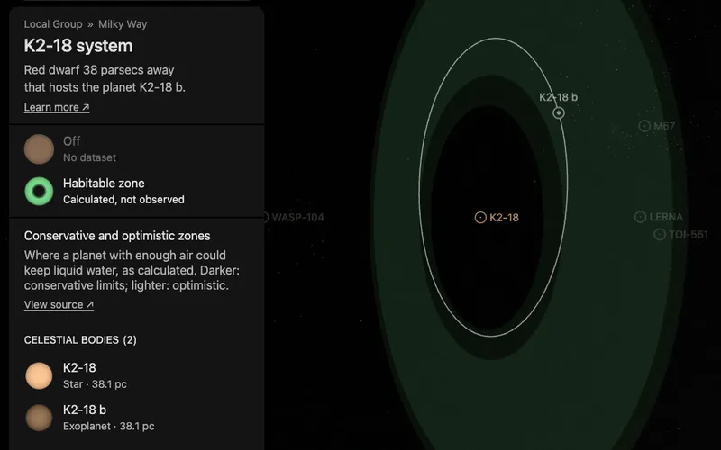

# K2-18's habitable zone

A flat green band around [K2-18](../k2-18/README.md), drawn in the plane of its planet' orbit. It is what the star's dataset
"Habitable zone" shows, a dataset of the whole system: the star's card and its system's card both list it. It has no page
of its own: it is a plane bank, one prepared picture the world lays in the system.

The band is a calculation, not an observation. It marks where a planet with enough atmosphere could keep liquid water
on its surface, by one published model. A planet inside it is not known to be habitable.

## Sources

- **The four distances.** The [Habitable Zone Gallery](https://hzgallery.org) (Kane & Gelino 2012,
  [PASP 124, 323](https://doi.org/10.1086/665271)) lists, for each planet, its star's habitable zone in au. The kept
  file, [`k2-18.json`](source/hzgallery/k2-18.json), holds the 2 rows of this system from the Gallery's JSON product
  (`https://hzgallery.org/data/hzgallery.json`, 3,938,737 bytes, last updated 2026-10-08). All give the same four numbers.
- **The method.** The Gallery calculates the distances by Kopparapu et al. (2013,
  [ApJ 765, 131](https://doi.org/10.1088/0004-637X/765/2/131); 2014,
  [ApJ 787, L29](https://doi.org/10.1088/2041-8205/787/2/L29)) from the star's temperature and luminosity: 3,457 K and
  0.02166 times the Sun's luminosity in the row read.
- **Terms.** The Gallery states no licence. It asks for the acknowledgement "This research has made use of the
  Habitable Zone Gallery at hzgallery.org" and a citation of Kane & Gelino (2012).

| Zone | Inner edge | Outer edge | Limits |
| --- | --- | --- | --- |
| Conservative | 0.1526 au | 0.2969 au | Runaway greenhouse to maximum greenhouse |
| Optimistic | 0.1204 au | 0.3132 au | Recent Venus to early Mars |

## Processing

[`habitable-zone.mts`](../../../packages/bake/authoring/system-planes/habitable-zone.mts) (`k2-18-habitable-zone`) reads the recipe,
[`zone.json`](source/zone.json), and writes the descriptor, the prepared plane and its picture: the same picture, colors
and opacities as [TRAPPIST-1's](../trappist-1-habitable-zone/README.md), a presentation choice.

- **Plane.** The star's world position is the centre. The plane's normal is the planet's orbit normal as
  the world draws it; it transits, so its tilt is measured.

## Evidence

- **Against the orbits.** With the orbits the planet pages use: b (0.159 au) lies in the conservative zone.

## Known problems

- **The limits assume a planet like Earth.** They are for a planet of one Earth mass with water, and a carbon dioxide
  and nitrogen atmosphere. Whether the planet has such an atmosphere is not known.
- **Another luminosity.** The Gallery calculates from 0.02166 solar luminosities; the [star's measurements record](../k2-18/source/measurements.json)
  holds 0.02529. With it every edge would lie 8% farther out, and b would fall in the optimistic strip inside the conservative zone. The band is drawn as the Gallery calculates it.
- **The plane's turn on the sky is a convention.** Transits do not measure the orbits' position angle, so the orbits are
  drawn with their node at celestial north, and the band lies in that plane.
- **The band has no label in the world.** The dataset's card names it; nothing is written on the band itself.

[Inputs](source/manifest.json) · [Delivered files](inventory.json)
