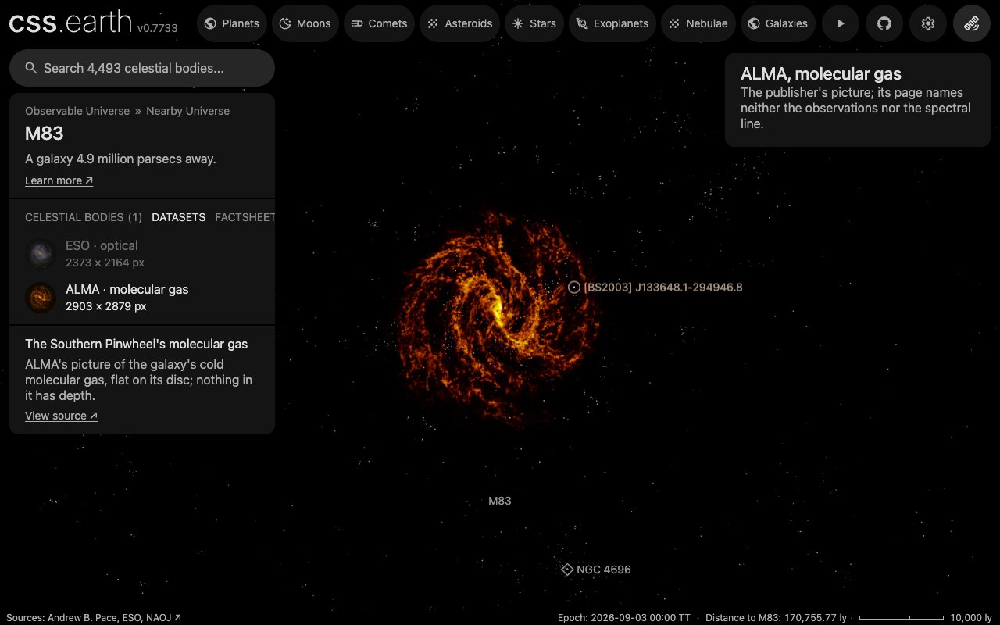

# Southern Pinwheel (M83), ALMA molecular gas

ESO's ALMA picture of M83's cold molecular gas, laid as one flat image on the disc that
[the photograph](../m83-layers/README.md) uses. It is the second dataset of [the M83 page](../m83/README.md).
**The picture shows where the gas is on the sky. Nothing in it has depth, and no thickness of the gas layer is drawn.**

## Sources

| Selected source | Input and meaning |
| --- | --- |
| [ESO potw2640a](https://www.eso.org/public/images/potw2640a/) | [Record](../../sources/eso-potw2640a.json). "A swirling galaxy", ESO's Picture of the Week of 5 October 2026: 2903 × 2879 px (`source/source.jpg`, the publisher's Large JPEG, restored from its origin). Credit: ALMA(ESO/NAOJ/NRAO)/J. Koda et al. In ESO's words it "depicts the light emitted by cold gas molecules"; the page names neither the spectral line nor the observations. A display picture, not calibrated intensities. |
| [Koda et al. (2025)](https://arxiv.org/abs/2505.08876) | [Record](../../sources/koda-2025-m83-co-line-ratio.json). The paper the picture's page links: the ratio of two carbon monoxide lines across M83, from ALMA data at 46 pc resolution. It says what the survey observed; none of its numbers is drawn. |
| [ESO potw2640b](https://www.eso.org/public/images/potw2640b/) | [Record](../../sources/eso-potw2640b.json). The visible-light picture ESO released with the gas picture for a comparison, the same size (`source/registration-visible.jpg`, restored from its origin). Not drawn: its stars place the frame on the sky. |
| [Gaia DR3](https://doi.org/10.1051/0004-6361/202243940) | [Record](../../sources/gaia-2023-dr3.json). The 551 sources within 0.2° of M83 brighter than G 18.5 (`source/gaia-dr3-field.csv`, restored by the query in the [manifest](source/manifest.json)). |
| [Lundgren et al. (2004)](https://arxiv.org/abs/astro-ph/0404026) | [Record](../../sources/lundgren-2004-m83-molecular-kinematics.json). The disc: inclination 24°, line of nodes 45°, as in the photograph's bank. |
| [Local Volume Database](../../sources/lvdb-v1-1-1.json) | Centre and distance, as in the photograph's bank: 4.90 Mpc. |

## The picture

- **Place on the sky:** neither the page nor the file gives sky coordinates, so they are measured
  ([place-gas-picture.mts](../../../packages/bake/authoring/m83/place-gas-picture.mts)). In the visible-light picture
  102 of the 204 Gaia stars in the frame are found and miss a linear fit by 0.23″ rms: 0.2498″ a pixel, north 0.015°
  right of vertical, centre 204.247881°, −29.868878°, field 12.09 × 11.99 arcmin. The 46 stars brighter than G 16 are
  saturated patches, left out of the fit; 42 of them lie within 8 px of where it puts them, at a median 0.29″.
- **The two pictures share their pixels:** gas and dust lanes are the same clouds. Slid over the visible picture's
  dust lanes, the gas picture fits best 0.35″ left and 0.60″ up over the whole frame, and between 0.17″ and 0.42″
  left and 0.27″ and 0.90″ up in each quarter. That is under half of the survey's 46 pc (1.9″), so the star fit's
  frame is used unchanged.
- **Opacity:** the bake draws a pixel's brightness as its opacity and keeps its color, so the black sky is clear and
  the brightest gas is opaque. The orange is the publisher's color.
- **Sky:** the picture's sky is 14, 12 and 7 of 255 in red, green and blue (each channel's median over the frame's
  outer ring), and 99% of that ring is under 22. The recipe's floor, 0.0863 (22 of 255), takes it away. The level is a
  choice made here; it also takes the gas's faintest light.
- **Disc:** one flat image on the midplane of the photograph's disc, tilted 24° with its line of nodes at 45°. The
  picture's light reaches 7.75 kpc from the page's place in the disc's plane, and the frame's nearest edge is 8.42 kpc
  away, so the fade from 7.8 to 8.4 kpc (a choice made here) dims none of it.
- **Size:** drawn 1,024 px on its long side, 0.71″ a pixel against the survey's 1.9″.

## Reproduce

```sh
node packages/bake/cli/restore-source-inputs.mts --object=m83-alma-layers
node packages/bake/authoring/m83/place-gas-picture.mts
node packages/bake/cli/prepare-image-layers.mts src/objects/m83-alma-layers
node site/build/prepare/catalog/prepare-volume-presentation.mts --object=m83-alma-layers
pnpm prepare:objects --object=m83
```

The second prints the fit, the slide and the sky, and fails when the recipe's observation is not the fit's.

## Evidence



The app on this dataset, fully loaded, captured on 12 October 2026 in Chrome at 1280 × 800.

## Known problems

- The page does not say which line the picture shows, or how its brightness was stretched. Opacity here follows the
  picture's brightness, not a measured amount of gas.
- The frame's place rests on ESO having drawn both pictures of its comparison on the same pixels. The dust lanes
  confirm it to about 1″; no star shows in the gas picture to confirm it directly.
- The floor removes the faintest gas along with the sky.
- The picture ends 7.8 kpc from the centre. The molecular clouds found farther out, in M83's extended ultraviolet
  disc ([Koda et al. 2024](https://arxiv.org/abs/2410.00180)), are not in it.
- The gas is drawn with no thickness. M83's cloud survey takes its gas layer to be about 100 pc thick, the Milky
  Way's value ([Hirota et al. 2024](https://arxiv.org/abs/2410.05424), Sect. II.2); no measurement in M83 was found.
  On a disc 15.6 kpc across that is 1 part in 156. A trial that drew it took 58 images where this takes 1, and in
  the app it could not be told from the flat image.
