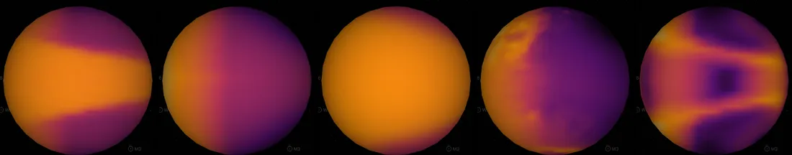

# Proxima Centauri b

## Sources

Proxima Centauri b is the first planet found around the nearest star to the Sun. It is known only from the star's radial velocity and does not cross its star. **Its tilt is not measured.** The page draws it in the star's equatorial plane, as an approximate placement; its period, timing, orbit size and minimum mass follow Suárez Mascareño et al. (2025), "Diving into the planetary system of Proxima with NIRPS", A&A ([doi:10.1051/0004-6361/202553728](https://doi.org/10.1051/0004-6361/202553728)), and its size is a model.

**Size and mass.** Radius 0.0913 Jupiter radii from the NASA Exoplanet Archive's calculated radius (its Chen & Kipping 2017 mass-radius relationship): a model, not a measurement, since Proxima Centauri b does not transit (https://exoplanetarchive.ipac.caltech.edu/docs/pscp_calc.html): 6,527.2 km at 71,492 km per Jupiter radius. GM from the mass 0.003319 +/- 0.000173 Jupiter masses (Suárez Mascareño et al. (2025), A&A, doi:10.1051/0004-6361/202553728, Table 3: minimum mass (m sin i) 1.055 +/- 0.055 Earth masses from the star's radial velocities; the same table gives 1.44 +/- 0.21 Earth masses for an orbit in the star's equatorial plane, tilted 47 degrees, https://doi.org/10.1051/0004-6361/202553728) times JPL's Jupiter GM. A sphere: no oblateness is measured.

**Orbit.** Table 3 of Suárez Mascareño et al. (2025), a fit of the star's radial velocities from HARPS, ESPRESSO and NIRPS with the eccentricity fixed to zero, gives the orbit within its plane: period 11.18465 ± 0.00053 d; time of inferior conjunction 2460548.59 ± 0.12 BJD (60548.09 BMJD_TDB, the planet nearest the observer); semi-major axis 0.04848 ± 0.00029 au, divided by the star's recorded radius of 98,094 km to give a/R* 73.93.

**Assumed plane.** Radial velocities do not give an orbit's tilt, and no paper measures Proxima Centauri b's. The record sets the tilt to 47°, the tilt of the star's rotation axis that Klein et al. (2021), MNRAS 500, 1844 measure as 47° ± 7° from the star's magnetic field: that is, it assumes the planet orbits in the star's equatorial plane. Suárez Mascareño et al. print the planet's mass under the same assumption. This page cites no test of that assumption for a planet like this one; Garraffo et al. (2022) note that the planet's tilt to the star's axis is not known. The direction of the orbit on the sky is a display convention (ascending node at position angle 0). The orbit record says so (`placement: approximate`), and the app shows it as it shows a moon whose orbit is not uniquely known: the path is dashed and the planet is named "(approx)".

**Color.** No image or measured color exists. The neutral gray is lit by proxima-centauri's measured color (#ffd06e, the color dataset of proxima-centauri (src/objects/proxima-centauri/source/photometry/stellar-color.json)) at the gray's own brightness.

**Climate model.** The default dataset is surface air temperature from the published ROCKE-3D simulation of [Del Genio et al. (2019)](https://doi.org/10.1089/ast.2017.1760), experiment 1, Control. It assumes a 0.984-bar nitrogen atmosphere with 376 ppm carbon dioxide, a dynamic global ocean 900 m deep with salinity 35.4 psu, and synchronous rotation with an 11.2-day period. None of that atmosphere, ocean or rotation has been measured on Proxima b. This is a climate scenario, not its observed appearance. The neutral shape remains selectable.

The [NASA NCCS native release](https://portal.nccs.nasa.gov/GISS_modelE/ROCKE-3D/publication-supplements/DelGenio2019Astrobio19-Habitable_Climate_Scenarios_for_Proxima_Centauri_B/AIJ/) supplies `01_Control_ANN3900-3999.aijProxCenb04bTL.nc`. The shared NetCDF reader reads `tsurf`, which the file calls SURFACE AIR TEMPERATURE, in degrees Celsius, on 72 longitude samples by 46 latitude samples (5° × 4°), including both poles. The star is overhead at source longitude 180°: the incoming-radiation field peaks at its two nearest grid nodes, ±177.5°, so that meridian becomes body longitude zero. The prepared map uses bilinear sampling and keeps the native field unchanged; its false-color legend spans -70 to 10 °C.

**Four more datasets from the same release.** The NASA NCCS release of Del Genio et al. (2019) holds 18 runs; the paper's Table 2 describes 12 of them. Three of those 12, and one more field of the control run, are shown, each read by the same NetCDF reader from its own released file:

| Dataset | Run | Field | Released range | Star overhead |
| --- | --- | --- | --- | --- |
| Static ocean model | 02 Thermo: a 100 m ocean that carries no heat | `tsurf` | -88.5 to 19.0 °C | grid 180° |
| Early-Earth air model | 09 Archean High: 10,000 ppm CO₂, 2,000 ppm CH₄ | `tsurf` | -43.7 to 6.1 °C | grid 180° |
| Earth-land model | 18 Day-Land: Earth's continents, Africa under the star | `tsurf` | -92.5 to 30.6 °C | grid 30° E |
| Model wind | 01 Control | `wsurf` | 0.8 to 12.9 m/s | grid 180° |

The four temperature maps, the Climate model's included, share one false-color scale from -100 to 40 °C, so the runs can be compared; the Climate model's was -70 to 10 °C before. The wind runs from 0 to 15 m/s. The point under the star is the incoming-radiation field's peak, found at the two grid nodes either side of it (±177.5° for the synchronous runs, 27.5° and 32.5° E for Day-Land, which the paper places at 30° E).

**Which runs.** Chosen by measurement (the area-weighted correlation of each run's surface temperature with every other's, scratch, not committed). Archean High and High Salinity are alike at 0.88: Archean High stands for both. Day-Ocean is alike with Thermo at 0.84. The two 3:2 spin-orbit runs are left out, since this page draws the planet keeping one face to its star. The six runs the release holds beyond the paper's table (Control-Thin, Control-Thick, Archean-Med without methane, Pure-CO2, Control-Shallow and Control-Deep) are left out, since no text says what they assume. The control run's sea ice (80% of the globe at its scale's ends), clouds (59%) and outgoing heat (correlation -0.92 with its temperature) would add nothing to the Climate model map.

**Averaging and limits.** The file is a released mean with the filename interval `ANN3900-3999`; its `fromto` attribute reports 100.00 model days. These labels are preserved without turning them into Earth calendar dates or a number of orbital periods. The field ranges from -63.2461 to 3.2427 °C with no missing cells. Table 5 rounds the paper’s control summary to -59 to 3 °C: its minimum differs from this released surface-air field, so this view does not claim to reproduce that table exactly. Other published atmosphere, salinity and rotation scenarios have different climates; they are not averaged into this one. With Shadows on, lighting darkens the night half visually.

**Charts.** The orbits of Proxima Centauri's planets from above, from their hosted-orbit records. Upper limits and rows without an error are left out.

## Evidence

Generated 2026-10-10 by [new-object-cli.mts](../../../packages/telescope-cli/src/new-object/new-object-cli.mts); the orbit is the one recorded in [its astronomy record](../../../packages/astronomy/data/bodies/proxima-centauri-b.json).

Validated 2026-10-11 for the climate dataset and orientation-label changes in this package. The telescope API query of NASA’s archive confirmed the period and orbital size and returned no inclination. All 3,312 native grid cells matched SciPy’s independent NetCDF reader exactly after the longitude convention was applied. The [source/acquisition/NetCDF/content checks](../../../packages/bake/src/objects/raster/netcdf/netcdf-lonlat-field.test.mts) passed (20 tests across the affected owners); the [actual package and retained-DOM checks](../../../site/world/runtime-package.test.mts) passed (8 tests), including both dataset selections. Browser inspection verified the default model, neutral-shape switch, legend, minimum-mass and unknown-orientation facts, and the dashed orbit marked “(approx)” in the system view. The input restored byte-for-byte through the acquisition recipe, and all 37 runtime files in the three changed inventories were verified live on the asset origin.

## Known problems

- **Model climate.** No measured surface map was found in the examined sources. The climate map does not establish an atmosphere, ocean, weather or habitability. Its scenario predates the current radial-velocity fit and keeps the paper’s 11.2-day synchronous rotation; the navigable orbit retains the 2025 fit’s 11.18465-day period.
- **Assumed tilt.** See "Assumed plane" above. If the planet does not orbit in the star's equatorial plane, the orbit drawn here is tilted wrongly by an unknown angle. It does not transit: Jenkins et al. (2019), MNRAS 487, 268 rule out transits at the 200 ppm level with Spitzer, so its tilt is not 90°.
- **Mass.** 1.055 ± 0.055 Earth masses is the minimum mass (m sin i) from radial velocities. For the assumed 47° the paper gives 1.44 ± 0.21 Earth masses.
- **Size.** The radius is the NASA Exoplanet Archive's value calculated from the mass. Nobody has measured the planet's size, because it does not transit.
- **Quoted text.** The discovery card preserves a quotation from the Wikipedia article "Proxima Centauri b" (revision 1378868101) verbatim, CC BY-SA 4.0.

[Investigation ledger](investigations.json) · [Inputs](source/manifest.json) · [Preparation](source/preparation) · [Delivered files](inventory.json) · [Credits](NOTICE.md)
