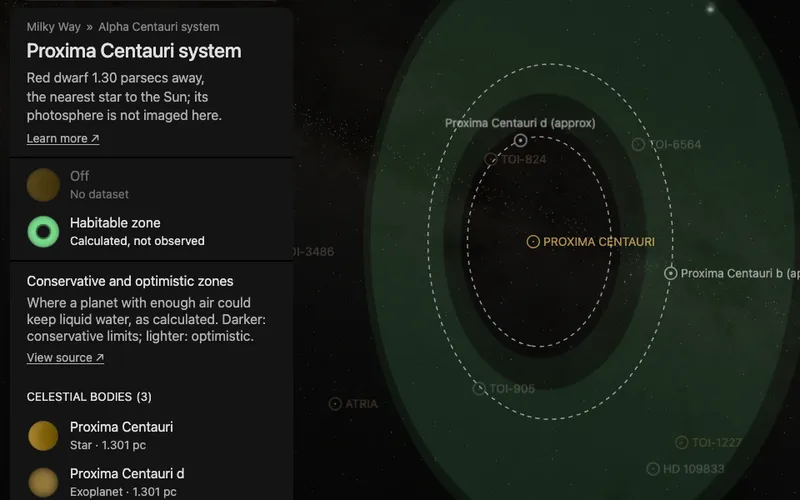

# Proxima Centauri's habitable zone

A flat green band around [Proxima Centauri](../proxima-centauri/README.md), drawn in the plane its planets' orbits are drawn
in. It is what the star's dataset "Habitable zone" shows, a dataset of the whole system: the star's card and its system's
card both list it. It has no page of its own: it is a plane bank, one prepared picture the world lays in the system.

The band is a calculation, not an observation. It marks where a planet with enough atmosphere could keep liquid water
on its surface, by one published model. A planet inside it is not known to be habitable.

## Sources

- **The four distances.** The [Habitable Zone Gallery](https://hzgallery.org) (Kane & Gelino 2012,
  [PASP 124, 323](https://doi.org/10.1086/665271)) lists, for each planet, its star's habitable zone in au. The kept
  file, [`proxima-centauri.json`](source/hzgallery/proxima-centauri.json), holds the two rows of this system from the
  Gallery's JSON product (`https://hzgallery.org/data/hzgallery.json`, 3,938,737 bytes, last updated 2026-10-08).
  Both give the same four numbers.
- **The method.** The Gallery calculates the distances by Kopparapu et al. (2013,
  [ApJ 765, 131](https://doi.org/10.1088/0004-637X/765/2/131); 2014,
  [ApJ 787, L29](https://doi.org/10.1088/2041-8205/787/2/L29)) from the star's temperature and luminosity in the NASA
  Exoplanet Archive: 2,900 K and 0.00151 times the Sun's luminosity in the kept rows.
- **Terms.** The Gallery states no licence. It asks for the acknowledgement "This research has made use of the
  Habitable Zone Gallery at hzgallery.org" and a citation of Kane & Gelino (2012).

| Zone | Inner edge | Outer edge | Limits |
| --- | --- | --- | --- |
| Conservative | 0.0405 au | 0.0810 au | Runaway greenhouse to maximum greenhouse |
| Optimistic | 0.0320 au | 0.0854 au | Recent Venus to early Mars |

## Processing

[`habitable-zone.mts`](../../../packages/bake/authoring/system-planes/habitable-zone.mts) (`proxima-centauri-habitable-zone`)
reads the recipe, [`zone.json`](source/zone.json), and writes the descriptor, the prepared plane and its picture: the
same picture, colors and opacities as [TRAPPIST-1's](../trappist-1-habitable-zone/README.md), a presentation choice.

- **Plane.** The star's world position is the centre. The plane's normal is the mean of the orbit normals of planets b
  and d as the world draws them. Neither tilt is measured; both orbits are drawn in the star's equatorial plane.

## Evidence

- **Against the orbits.** With the orbits the planet pages use, b (0.048 au) lies in the conservative zone and d
  (0.029 au) inside the optimistic zone's inner edge.
- **The plane.** The two orbit normals lie within 0.000° of the plane's normal (printed by the script).

## Known problems

- **Another temperature.** The Gallery's rows use 2,900 K; the [star's page](../proxima-centauri/README.md) shows 3,098 K.
  The band is drawn as the Gallery calculates it.
- **The limits assume a planet like Earth.** They are for a planet of one Earth mass with water, and a carbon dioxide
  and nitrogen atmosphere. Whether Proxima b has an atmosphere is not known.
- **The plane is assumed.** Neither planet transits, so neither orbit's tilt is measured; the orbits, and the band, are
  drawn in the star's equatorial plane, 47° to the line of sight, and their turn about the line of sight is a convention.
- **The band has no label in the world.** The dataset's card names it; nothing is written on the band itself.

[Inputs](source/manifest.json) · [Delivered files](inventory.json)
