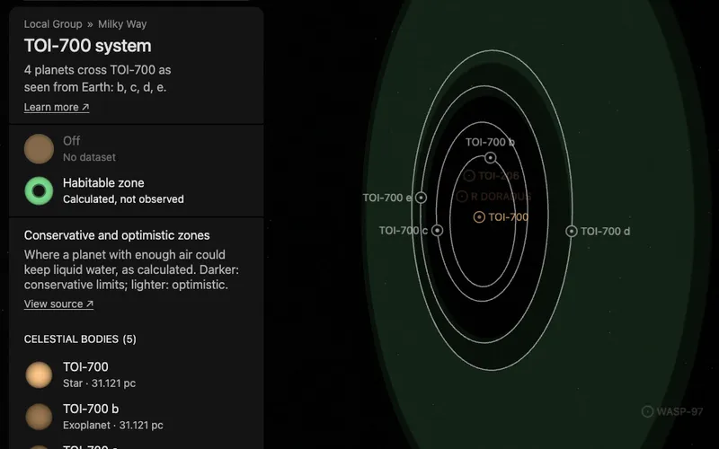

# TOI-700's habitable zone

A flat green band around [TOI-700](../toi-700/README.md), drawn in the plane of its four planets' orbits. It is what the
star's dataset "Habitable zone" shows, a dataset of the whole system: the star's card and its system's card both list
it. It has no page of its own: it is a plane bank, one prepared picture the world lays in the system.

The band is a calculation, not an observation. It marks where a planet with enough atmosphere could keep liquid water
on its surface, by one published model. A planet inside it is not known to be habitable.

## Sources

- **The method.** Kopparapu et al. (2014, [ApJ 787, L29](https://doi.org/10.1088/2041-8205/787/2/L29),
  [arXiv:1404.5292](https://arxiv.org/abs/1404.5292)), Equations 1 and 2 with the 1 Earth mass coefficients of their
  Table 1, kept as [`table-1.json`](source/kopparapu-2014/table-1.json). Their fit covers stars of 2,600 to 7,200 K.
- **The star.** Its temperature, 3,459 K (Gilbert et al. 2023), and luminosity, log L = -1.633 (Kokori et al. 2023 via
  the NASA Exoplanet Archive), are read from the [star's measurements record](../toi-700/source/measurements.json).
- **Why calculated here.** The [Habitable Zone Gallery](https://hzgallery.org), the source of the other systems' zones,
  does not list TOI-700, and no TOI-700 paper prints the distances: Gilbert et al. (2020, 2023) draw them in figures.
  The Gallery calculates by the same method; done here, it gives the Gallery's four distances for 55 Cnc and Proxima
  Centauri to the fourth decimal.

| Zone | Inner edge | Outer edge | Limits |
| --- | --- | --- | --- |
| Conservative | 0.1582 au | 0.3078 au | Runaway greenhouse to maximum greenhouse |
| Optimistic | 0.1249 au | 0.3247 au | Recent Venus to early Mars |

## Processing

[`habitable-zone.mts`](../../../packages/bake/authoring/system-planes/habitable-zone.mts) (`toi-700-habitable-zone`)
reads the recipe, [`zone.json`](source/zone.json), calculates the four distances and writes the descriptor, the prepared
plane and its picture: the same picture, colors and opacities as [TRAPPIST-1's](../trappist-1-habitable-zone/README.md),
a presentation choice.

- **Plane.** The star's world position is the centre. The plane's normal is the mean of the four planets' orbit normals
  as the world draws them; all four transit, so their tilts are measured, and they lie within 0.63° of the plane.

## Evidence

- **Against the orbits.** With the orbits the planet pages use, d (0.164 au) lies in the conservative zone and e
  (0.134 au) in the optimistic strip inside it, as Gilbert et al. (2020, 2023) state; b and c lie closer to the star than either zone.

## Known problems

- **The limits assume a planet like Earth.** They are for a planet of one Earth mass with water, and a carbon dioxide
  and nitrogen atmosphere. Whether d or e has an atmosphere is not known.
- **The plane's turn on the sky is a convention.** Transits do not measure the orbits' position angle, so the orbits are
  drawn with their node at celestial north, and the band lies in that plane.
- **The band has no label in the world.** The dataset's card names it; nothing is written on the band itself.

[Inputs](source/manifest.json) · [Delivered files](inventory.json)
