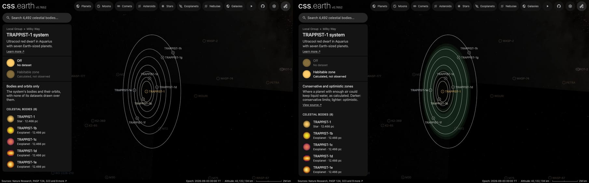

# TRAPPIST-1's habitable zone

A flat green band around [TRAPPIST-1](../trappist-1/README.md), drawn in the plane of its planets' orbits. It is what
the star's dataset "Habitable zone" shows, a dataset of the whole system: the star's card and its system's card both
list it. It has no page of its own: it is a plane bank, one prepared picture the world lays in the system.

The band is a calculation, not an observation. It marks where a planet with enough atmosphere could keep liquid water
on its surface, by one published model. A planet inside it is not known to be habitable.

## Sources

- **The four distances.** The [Habitable Zone Gallery](https://hzgallery.org) (Kane & Gelino 2012,
  [PASP 124, 323](https://doi.org/10.1086/665271)) lists, for each planet, its star's habitable zone in au. The kept
  file, [`trappist-1.json`](source/hzgallery/trappist-1.json), holds the seven rows of this system from the Gallery's
  JSON product (`https://hzgallery.org/data/hzgallery.json`, 3,938,737 bytes on 2026-10-10, last updated 2026-10-08).
  All seven give the same four numbers.
- **The method.** The Gallery calculates the distances by Kopparapu et al. (2013,
  [ApJ 765, 131](https://doi.org/10.1088/0004-637X/765/2/131); 2014,
  [ApJ 787, L29](https://doi.org/10.1088/2041-8205/787/2/L29)) from the star's temperature and luminosity in the NASA
  Exoplanet Archive: 2,566 K and 0.000553 times the Sun's luminosity in the kept rows.
- **Terms.** The Gallery states no licence. It asks for the acknowledgement "This research has made use of the
  Habitable Zone Gallery at hzgallery.org" and a citation of Kane & Gelino (2012).

| Zone | Inner edge | Outer edge | Limits |
| --- | --- | --- | --- |
| Conservative | 0.0246 au | 0.0499 au | Runaway greenhouse to maximum greenhouse |
| Optimistic | 0.0194 au | 0.0527 au | Recent Venus to early Mars |

## Processing

[`habitable-zone.mts`](../../../packages/bake/authoring/system-planes/habitable-zone.mts) (`trappist-1-habitable-zone`) reads the recipe,
[`zone.json`](source/zone.json), and writes the descriptor, the prepared plane and its picture.

- **Picture.** Three flat rings of one green on a 1,024-pixel square: the conservative zone at 16% opacity, and the two
  strips the optimistic zone adds, inside and outside it, at 7.5%. The color and the two opacities are a presentation
  choice. The picture is kept lossless.
- **Plane.** The star's world position is the centre. The plane's normal is the mean of the seven planets' orbit
  normals as the world draws them, each the cross product of the planet's position and velocity about the star.
- **When it shows.** The world draws it while the star's dataset "Habitable zone" is selected. It fades in as it grows
  past a few pixels, and fades out as the camera comes within 2 to 1.25 times the outer distance of the star: among the
  planets the plane is seen along itself, as a line across the view.

## Evidence

The system's page on a local build, 2026-10-10 (headless Chromium, 1,440 by 900): as it opens, and with the dataset
selected.

- **Against the orbits.** With the semi-major axes of Agol et al. (2021) that the planet pages use, d (0.0223 au) lies
  in the optimistic zone only, e (0.0293 au), f (0.0385 au) and g (0.0468 au) lie in the conservative zone, and b, c
  and h lie outside both. The Gallery's own table says the same: d spends 100% of its orbit in the optimistic zone and
  none in the conservative one; e, f and g spend 100% in both.
- **The plane.** The seven orbit normals lie within 0.113° of the plane's normal, and no planet stands more than 0.110°
  off the plane (printed by the script).

## Known problems

- **The star is just outside the model's range.** Kopparapu et al. fit stars from 2,600 K to 7,200 K; the Gallery's
  temperature for TRAPPIST-1 is 2,566 K, 34 K below it.
- **The limits assume a planet like Earth.** They are for a planet of one Earth mass with water, and a carbon dioxide
  and nitrogen atmosphere. Whether any of the seven has an atmosphere is not known.
- **The plane's turn on the sky is a convention.** Transits do not measure the orbits' position angle, so the planets'
  orbits are drawn with their node at celestial north, and the band lies in that plane.
- **The band has no label in the world.** The dataset's card names it; nothing is written on the band itself.

[Inputs](source/manifest.json) · [Delivered files](inventory.json)
