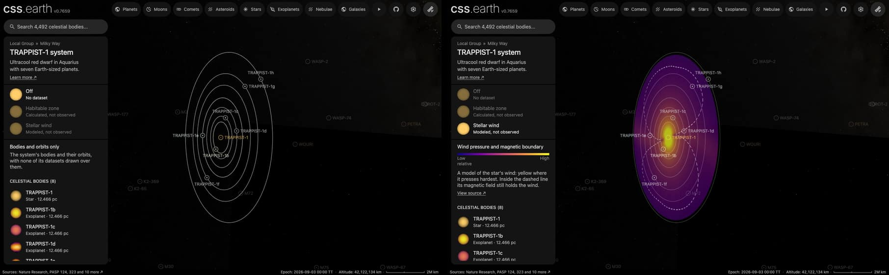

# TRAPPIST-1's stellar wind

A color map and a dashed white line around [TRAPPIST-1](../trappist-1/README.md), drawn in the plane of its planets'
orbits. It is what the star's dataset "Stellar wind" shows, a dataset of the whole system: the star's card and its system's card both
list it. It has no page of its own: it is a plane bank, one prepared picture the world lays in the system.

The picture is a model, not an observation. No telescope has seen this star's wind. The colors are the wind's pressure
in one published simulation: yellow where it is highest, near the star, through orange and purple to dark blue where it
is lowest. The dashed line is the Alfvén surface: inside it the star's magnetic field still holds the wind, and outside
it the wind has broken free.

## Sources

- **The model.** Garraffo et al. (2017, [ApJL 843, L33](https://doi.org/10.3847/2041-8213/aa79ed),
  [arXiv:1706.04617](https://arxiv.org/abs/1706.04617v1)) simulate the star's corona and wind with the BATS-R-US code's
  Alfvén Wave Solar Model. TRAPPIST-1's magnetic map is not measured, so the model takes the map of another star,
  GJ 3622, scaled to TRAPPIST-1's measured mean field of about 600 G.
- **The figure.** The picture is read from the paper's Figure 3, left: the wind's total pressure (magnetic plus
  dynamic) in the plane of the orbits, the seven orbits as colored circles, and the Alfvén surface as a white line. The
  file is `TrB2_2D_0deg_tot.png` (131,566 bytes, 2,000 by 1,778 pixels) in the preprint's source bundle,
  `https://arxiv.org/e-print/1706.04617v1`.
- **What the paper says of it.** Wind speeds reach close to 1,400 km/s. The total pressure at the orbits is 3 to 6
  orders of magnitude above the solar wind's at 1 au. All but the outermost planet spend a large part of their orbits
  inside the Alfvén surface, crossing it four times an orbit.
- **Terms.** The preprint is under [arXiv's non-exclusive license](https://arxiv.org/licenses/nonexclusive-distrib/1.0/),
  which grants no reuse of its figures. The figure is not tracked, mirrored or redistributed. The prepared picture is
  this project's drawing of values read from it.

## Processing

[`stellar-wind.mts`](../../../packages/bake/authoring/trappist-1/stellar-wind.mts) reads the recipe,
[`wind.json`](source/wind.json), fetches the figure when it is missing, and writes the descriptor, the prepared plane
and its picture.

- **Pressure.** The figure's color scale runs red, yellow, green, cyan, blue. The script reads each pixel's place on it,
  from 0 at red (the highest pressure) to 4 at blue.
- **Lines removed.** The seven orbit circles and the white line lie over the field. The script finds each circle's
  radius, sets those pixels aside, and fills them with a Gaussian average (4 pixels wide) of the field beside them.
- **Boundary.** A pixel between the white line and the field keeps a share of white in its weakest channel. That share
  is the line's coverage. The figure's line is about 7 pixels wide; it is redrawn 3 wide about its own middle, and cut
  into dashes by its own length, 20 figure pixels drawn and 14 left out, so that it does not read as one more orbit.
  Along itself the line measures 3,818 figure pixels.
- **Scale.** The figure's circles for planets b to g are laid on the orbits the world draws, by one least-squares scale.
- **Picture.** A 1,024-pixel square. The pressure is drawn on the five-color scale the application's other false-color
  maps use, dark blue at the blue end of the figure's scale and yellow at its red end, 35% opaque at the low end and
  75% at the high end. The boundary lies over it in white at 85%. The palette and opacities are a presentation choice.
  The picture goes through the lossy lane (66,390 bytes; 160,738 lossless).
- **Plane.** The same as the [habitable zone](../trappist-1-habitable-zone/README.md)'s: the star's world position and
  the mean of the seven planets' orbit normals.
- **When it shows.** The world draws it while the star's dataset "Stellar wind" is selected. It fades out as the camera
  comes within 2 to 1.25 times the picture's radius of the star.
- **Orbits beside it.** While the picture shows whole, the world draws its orbit lines at about 40% of their opacity
  (`orbitOpacity` in the recipe), so the lines do not compete with the map. They return as the picture fades, and an
  orbit the reader points at keeps its own. Read on the system page on 2026-10-11: the lines' stroke opacity is 0.264
  with the dataset selected and 0.65 with "Off" or "Habitable zone".

## Evidence

The system's page on a local build, 2026-10-11 (headless Chromium, 1,440 by 900): as it opens, and with the dataset
selected.

Printed by the script on 2026-10-11:

| Planet | Figure's circle | On the scale | World's orbit | Difference | Meets the white line |
| --- | --- | --- | --- | --- | --- |
| b | 106.5 px | 0.01144 au | 0.01155 au | -1.01% | 2 times |
| c | 147.5 px | 0.01584 au | 0.01583 au | 0.10% | 4 times |
| d | 207.5 px | 0.02228 au | 0.02229 au | -0.04% | 4 times |
| e | 273.5 px | 0.02937 au | 0.02930 au | 0.25% | 4 times |
| f | 359.5 px | 0.03861 au | 0.03855 au | 0.15% | 4 times |
| g | 436 px | 0.04682 au | 0.04689 au | -0.14% | 4 times |
| h | 560 px | 0.06014 au | 0.06198 au | -2.97% | 0 times |

- **The scale holds.** Six circles lie within 1.01% of their orbits, by one scale of 107.40 millionths of an au per
  pixel.
- **The crossings agree with the paper** for c to g (four each) and h (none). On the figure b only touches the line, at
  the two notches where the line reaches its orbit.

## Known problems

- **A proxy star's magnetic map.** The pattern's shape, its two lobes and two notches, follows GJ 3622's map. The real
  star's would differ.
- **No scale.** The figure prints no color bar. The colors show where the pressure is higher, not by how much, and the
  legend reads only "Low" and "High".
- **One moment.** The pattern turns with the star, once in 3.3 days. The picture holds still, and its turn about the
  star is arbitrary.
- **The view.** The figure prints no axes. It is taken as seen from the side on which the planets orbit
  counterclockwise.
- **It ends inside planet h's orbit.** The figure ends at its own circle for h, which lies 3.0% inside the orbit the
  world draws.
- **The line stops at planet b's orbit.** The figure draws no boundary inside it.

[Inputs](source/manifest.json) · [Delivered files](inventory.json)
