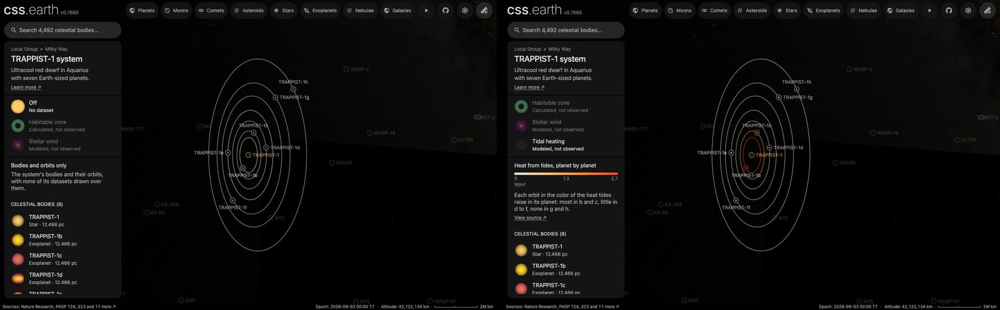

# TRAPPIST-1's tidal heating

The seven orbits of [TRAPPIST-1](../trappist-1/README.md)'s planets, each in one color. It is what the star's dataset
"Tidal heating" shows, a dataset of the whole system: the star's card and its system's card both list it. It has no page
of its own: it is a plane bank, and the world reads its colors from it.

A planet's color is the heat that tides raise inside it, by one published model. A planet on a slightly oval orbit is
pulled harder by its star when it is nearer and less when it is farther, and the flexing warms its rock. The colors show
a model, not an observation: no heat from any of these planets has been measured.

## Sources

- **The values.** Barr, Dobos & Kiss (2018, [A&A 613, A37](https://doi.org/10.1051/0004-6361/201731992),
  [arXiv:1712.05641](https://arxiv.org/abs/1712.05641)), Table 3, column `F_tidal`: the tidal heat flux at each planet's
  surface, from a model of its interior. The kept file, [`table-3.json`](source/barr-2018/table-3.json), holds the seven
  rows with their uncertainties, transcribed from the preprint on 2026-10-11.
- **The paper's own comparison.** Io, Jupiter's volcanic moon, has a tidal heat flux of about 1 to 2 W/m².
- **Terms.** Seven published numbers, kept with their citation.

| Planet | Tidal heat flux | Uncertainty |
| --- | --- | --- |
| b | 2.68 W/m² | +1.33, -1.81 |
| c | 1.32 W/m² | +0.3, -0.47 |
| d | 0.16 W/m² | +0.35, -0.16 |
| e | 0.18 W/m² | +0.09, -0.18 |
| f | 0.14 W/m² | +0.05, -0.14 |
| g | 0 W/m² | none printed |
| h | 0 W/m² | none printed |

## Processing

[`tidal-heating.mts`](../../../packages/bake/authoring/trappist-1/tidal-heating.mts) reads the recipe,
[`heating.json`](source/heating.json), and the kept table, and writes the descriptor, the prepared plane and its picture.

- **Color.** Four stops, linear in the heat flux: the plain gray of an orbit line at no heat, through two ambers, to red
  at the table's highest value, 2.68 W/m². The stops are a presentation choice. The script writes one color for each
  planet into the descriptor (`bodyColors`): b `#f04624`, c `#ffa851`, d `#e5dacb`, e `#e5dac9`, f `#e4dbce`, g and h
  `#dfdfdf`.
- **What takes the color.** While the dataset is selected, the world draws each planet's orbit line and the ring and dot
  of its marker in that color. The lines keep their own width and opacity. Each name and the star keep their own color.
- **Picture.** Seven circles 3 pixels wide on a 1,024-pixel square, 5% opaque, each at the radius the world draws its
  orbit with and in its planet's color. The sidebar's tile is made from it; in the scene the orbit lines cover it.
- **Plane.** The same as the [habitable zone](../trappist-1-habitable-zone/README.md)'s: the star's world position and
  the mean of the seven planets' orbit normals.
- **When it shows.** The colors hold while the star's dataset "Tidal heating" is selected, and each body returns to its
  own color when another dataset or Off is.

## Evidence

The system's page on a local build, 2026-10-11 (headless Chromium, 1,440 by 900): as it opens, and with the dataset
selected. Read from that page:

| Planet | Orbit line, ring and dot with the dataset | Name with the dataset | Orbit line and ring with Off |
| --- | --- | --- | --- |
| b | `rgb(240, 70, 36)` | `rgb(255, 252, 226)` | `rgb(255, 252, 226)` |
| c | `rgb(255, 168, 81)` | `rgb(223, 223, 223)` | `rgb(223, 223, 223)` |
| d | `rgb(229, 218, 203)` | `rgb(223, 223, 223)` | `rgb(223, 223, 223)` |
| e | `rgb(229, 218, 201)` | `rgb(239, 249, 255)` | `rgb(239, 249, 255)` |
| f | `rgb(228, 219, 206)` | `rgb(223, 223, 223)` | `rgb(223, 223, 223)` |
| g | `rgb(223, 223, 223)` | `rgb(223, 223, 223)` | `rgb(223, 223, 223)` |
| h | `rgb(223, 223, 223)` | `rgb(223, 223, 223)` | `rgb(223, 223, 223)` |

With Off every dot is `rgb(154, 154, 154)`. The star reads `rgb(255, 205, 106)` in both.

## Known problems

- **Large uncertainties.** Planet b's 2.68 W/m² stands between 0.87 and 4.01, and d's range reaches down to zero.
- **Old inputs.** The model rests on the masses and orbit shapes published in 2017. Dobos, Barr & Kiss (2019,
  arXiv:1902.03867) redo planets b to e with later masses, and a 2026 paper (arXiv:2601.03408) shows ranges that depend
  on each planet's interior, as figures. The 2018 table is the one found that prints a value for all seven.
- **Zero for g and h.** The paper found no equilibrium for these two and prints a flux of 0. They are drawn in the
  scale's lowest color, the gray of an ordinary orbit line.
- **An orbit is not the heat's place.** The heat is inside the planet. Its whole orbit takes the color so that the seven
  can be compared at a glance.
- **A faint tile.** The sidebar's tile is the 5% circles, brightened; it is dimmer than the other datasets' tiles.
- **A linear scale hides the small values.** d, e and f differ by 0.04 W/m² and look alike.

[Inputs](source/manifest.json) · [Delivered files](inventory.json)
