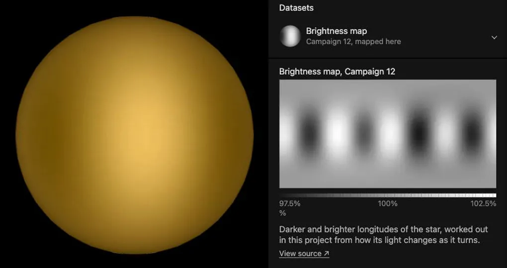

# TRAPPIST-1

The [navigation marker](source/preparation/navigation.json) adds a prepared curvature cue to the existing neutral gray placeholder. It remains a schematic identifier without resolved surface imagery; the shading is a display convention, not measured limb darkening or surface detail.

## Sources

TRAPPIST-1 is an ultracool red dwarf 12.47 parsecs away in Aquarius, with seven transiting Earth-sized planets. The star is barely
larger than Jupiter, and all seven orbits fit inside 0.062 au: the whole system would sit well within Mercury's orbit.

**Placement.** Gaia DR3 source 2635476908753563008, archived as `source/photometry/gaia-dr3-source.csv` (restored and pinned in the [manifest](source/manifest.json)):
ICRS position at epoch J2016.0, parallax 80.2123 +/- 0.0716 mas (12.467 pc) and a proper motion of 930.8, -479.0 mas/yr, the largest
of any star in this application. Gaia publishes no radial velocity for it — the star is too cool and too faint in BP — so the
-52.003 +/- 0.134 km/s of Jeffers et al. (2020) is used, through SIMBAD.

**Radius and mass.** 0.1192 solar radii (82,927 km) and 0.0898 +/- 0.0023 solar masses, from Agol et al. (2021, PSJ 2, 1), who
derive the radius from the photodynamic stellar density and the mass from the Mann et al. (2019) relation.

**Color dataset.** Gaia measured this star's BP/RP spectrum, but publishes the *sampled* product only for brighter sources; at G =
15.62 only the basis-function coefficients are released. They are pinned as
`source/photometry/gaia-dr3-xp-continuous.csv` and sampled here onto the archive's own
336-1020 nm grid with GaiaXPy, the archive's library, by
[`xp-continuous-sample.py`](../../../packages/bake/src/objects/stellar/xp-continuous-sample.py). Through the CIE 1931 2-degree observer
that gives **255, 205, 106 (#ffcd6a)**.

The star is faint in blue light: from 380 to 450 nm its samples have a mean signal-to-noise of 0.2 and sixteen of them are at or
below zero. A sample that is not positive but lies within three times its own error of zero is read as no emission at that
wavelength; anything more negative would fail the build. Moving every sample one standard error down and up moves the blue channel
from 34 to 156, which is the honest width of this color.

**Limb layer.** Nothing resolves this disc, so its limb is a model.
[Claret, Hauschildt & Witte (2012)](https://doi.org/10.1051/0004-6361/201219849) compute quadratic limb-darkening laws,
`I(μ)/I(1) = 1 - u1(1 - μ) - u2(1 - μ)²`, from PHOENIX model atmospheres in each photometric band.
[`claret-2012-bvr-quadratic.tsv`](source/photometry/claret-2012-bvr-quadratic.tsv) keeps their R, V and B rows at the four grid
nodes around the star (2,500 and 2,600 K, log g 5.0 and 5.5). Read at the star's 2,566 K and log g 5.2396 (Agol et al. 2021,
through the NASA Exoplanet Archive), one band darkens each color channel:

| Channel | Band | u1 | u2 | At 87% of the radius | At the edge |
| --- | --- | --- | --- | --- | --- |
| Red | R | 0.953 | -0.079 | 54% of the centre | 13% |
| Green | V | 1.056 | -0.165 | 51% | 11% |
| Blue | B | 1.415 | -0.463 | 41% | 5% |

Blue darkens most and red least, so the edge is dimmer and redder than the centre. The prepared plate is colored, not black: its
alpha darkens the blue channel, and its color holds red and green at their own laws, with transparent pixels outside the disc. It
replaces one near-infrared law (Gillon et al. 2016, I+z at 885 nm, a transit prior from atmosphere tables) that darkened the three
channels alike, so the hue never changed across the disc. This is a **model**, not a resolved image or a measured profile, and it
claims no off-limb glow.

Left: css.earth on 2026-10-12, with the one I+z law. Right: this recipe, from the branch's site. Both are the default view in
headless Chrome at 1440 by 900 (DPR 2), cropped to the disc.

**Axis.** No rotation axis is measured. The period is known from spot modulation — 3.295 days (Luger et al. 2017) — but not the
direction of the axis on the sky, so the display axis is celestial north at the star, a convention.

**On the map.** The star has no surface image, but its color comes from its own spectrum, so discovery marks it `sourceColor` and
it stays on the map with its seven planets.

**Light curve at 15 µm.** The page's chart is TRAPPIST-1's brightness over the 59 hours of JWST program 3077, reduced from raw in
this project ([`white-15um.csv`](source/science/jwst-3077/white-15um.csv), in 20-minute averages): the transits of b, g, b again and c,
the shallow eclipse of b and c together, the star's own flares, and the detector settling over the first hours. The event labels are
the mid-times this project's joint fit of the ten visits gives. [TRAPPIST-1b](../trappist-1b/README.md)'s temperature map and
[TRAPPIST-1c](../trappist-1c/README.md)'s measured dayside come from the same data.

**Habitable zone dataset.** A dataset of the whole system: the star in its color, with its habitable zone as a green
band in the plane of the planets' orbits. The band is its own package, a drawing of four distances the Habitable Zone
Gallery calculates by Kopparapu et al. (2013, 2014); its sources, processing and limits are in
[its README](../trappist-1-habitable-zone/README.md). It is a calculation, not an observation.

**Stellar wind dataset.** A second dataset of the whole system: the star in its color, with a model of its wind's
pressure as a color map in the plane of the planets' orbits, and as a dashed line the boundary inside which the star's
magnetic field still holds the wind. It is its own package, read from a figure of Garraffo et al. (2017); its sources,
processing and limits are in [its README](../trappist-1-stellar-wind/README.md). It is a model, not an observation.

**Tidal heating dataset.** A third dataset of the whole system: each planet's orbit line and marker in the color of the
heat tides raise inside the planet, by the model of Barr, Dobos & Kiss (2018). It is its own package; its sources, processing
and limits are in [its README](../trappist-1-tidal-heating/README.md). It is a model, not an observation.

**Catalogue color.** the swatch that search, the catalogue and the minimap show is this dataset's prepared color, #ffcd6a.

**Brightness from K2.** The Color + brightness and Brightness map datasets are made in this project from the star's EVEREST light curve of K2 campaign 12 (December 2016 to March 2017), which its authors make from the K2 mission's pixels and keep at [MAST](https://archive.stsci.edu/hlsp/everest) ([source record](../../sources/mast-everest-light-curves.json)). It is the light curve [Luger et al. (2017, Nature Astronomy 1, 0129)](https://arxiv.org/abs/1703.04166) measured, and their sentence (Methods, the paragraph that establishes the rotation period and the flare rate: "The rotation period is determined to be 3.30 ± 0.14 d.") is their verdict that it shows the star turning: the period is theirs and nothing is judged here, and starry (Luger et al. 2019) makes the map that reproduces it ([method](../../../docs/stellar-brightness-maps-from-tess.md)). The map's table is built by `packages/telescope-cli/src/archives/tess/reduce.mts` and restored from the source cache.

## Evidence

- [`stellar-photometric-color.test.mts`](../../../packages/bake/src/objects/stellar/stellar-photometric-color.test.mts) covers the color
  path, including the rule for samples consistent with zero and the limb plate with one law per color channel: composited over
  the photosphere color, each channel is within 1.5 of 255 steps of its law.
- `source.test.mts` checks every package's source pins, and that each planet turns
  synchronously with longitude 0 on the star and orbits it.
- [`object-systems.test.mts`](../../../site/world/systems/object-systems.test.mts) checks that the system holds all seven planets.
- Driven in a real browser: the system view draws the seven orbits, markers and labels around the star. The orbits are inclined
  89.7 to 89.9 degrees with the node at celestial north, so from the default angle they project onto a single line — the geometry
  that makes these planets transit.
- Run of 2026-09-21: [`object-package-consistency.test.mts`](../../../packages/telescope-cli/src/new-object/object-package-consistency.test.mts) checks that the catalogue color #ffcd6a is the color dataset's prepared color.

**Brightness from K2.** Luger et al. (2017, Nature Astronomy 1, 0129) take the frequency of the strongest peak in the Discrete Fourier Transform of the light curve, after outliers, transits, flares and the low frequencies left by the detrending are taken out, fitted by non-linear least squares. Their text (Methods, the paragraph that establishes the rotation period and the flare rate: "The rotation period is determined to be 3.30 ± 0.14 d.") gives a rotation period of 3.30 ± 0.14 d: the star's period is 3.3 d, as published, and no criteria were applied to it here. The light varies by 1.5% (the range between its 5th and 95th percentiles, measured here from the light curve the paper measured). The paper gives the period with an uncertainty of 0.14 d and prints no rate of false periods. Vida et al. (2017, ApJ 841, 124), from their own photometry of the same campaign's pixels, find 3.295 ± 0.003 d, and see no sign of the 1.40 d Gillon et al. (2016) read from the ground. The criteria of Holcomb et al. (2022, ApJ 936, 138), applied here to the star's TESS light, are not met: The autocorrelation of sector 70 gives 1.82 d with peaks of height -0.00, width 1.19 and fit 0.44, outside what Holcomb et al. (2022) accept (a height over a quarter of the width, a width between 0.4 and 0.6, a fit over 0.9). The star's record holds no catalogued rotation period to set it beside. The map's light curve leaves a scatter of 2.0% about the light, whose own noise is 1.7%. Gaia DR3 lists no other star within 16 arcseconds.

The star's page on 19 October 2026, in the local dev server of this change: the default view (Color + brightness, left) and the Brightness map card with its scale of 97.5% to 102.5% (right). Captured in the app's browser pane at 800 px wide.

## Known problems

**The blue end of the spectrum is noise.** Below about 450 nm this star is too faint for Gaia to measure, and those samples are
read as no emission. The one-sigma range above bounds what that can move.

**The limb's color is a three-band approximation.** The table's B, V and R bands stand for the screen's blue, green and red; the
spectrum is not passed through a law at each wavelength. The table is for solar metallicity.

**No image, diameter or axis.** The disc is about 0.09 milliarcseconds across; nothing resolves it.

**The system is seen almost edge-on from the Sun.** The seven orbits lie nearly in the line of sight, which is why they transit; on
arrival the overview turns up to 30° above their plane so they open into ellipses, as it does for every other star's system.

- **Brightness from K2.** Which longitudes are darker, and by how much, is measured. The latitude and shape of each patch are the smoothest that reproduce the light, and no color change of the spots is drawn. Color + brightness draws the contrast far stronger than it is, on the Brightness map's scale, so it can be seen; Brightness map has the measured values. The map is made at the tilt the page draws, 90°. The map is of December 2016 to March 2017: spots come and go within weeks or months.

[Investigation ledger](investigations.json) · [Inputs](source/manifest.json) · [Preparation](source/preparation) · [Delivered files](inventory.json) · [Credits](NOTICE.md)
