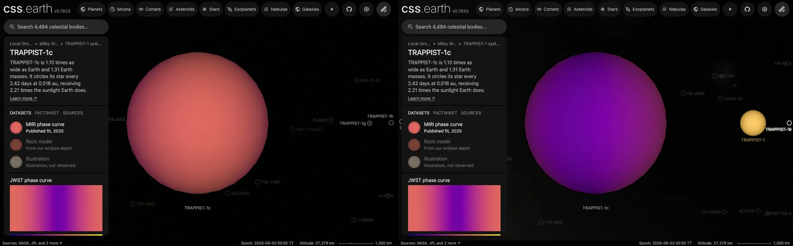

# TRAPPIST-1c

TRAPPIST-1c is the second planet out from [TRAPPIST-1](../trappist-1/README.md), an ultracool dwarf 12.47 parsecs away. It is shown with a MIRI phase curve dataset, the default, a Rock model dataset and an Illustration dataset. Nobody has resolved this planet's disc.

The [navigation marker](source/preparation/navigation.json) is a schematic identifier; its shading is a display convention, not measured limb darkening or surface detail.

## Sources

Every number in this package comes from Agol et al. (2021, PSJ 2, 1), who fitted the seven planets' transit times and the Spitzer and ground-based photometry together: the planets perturb each other enough for their masses to be read from the timing of their transits.

- **Size and mass.** 1.097 Earth radii and 1.308 Earth masses (Table 6), a density of 0.991 Earth's and a surface gravity of 1.086 Earth's. The mass is scaled by the stellar mass Mann et al. (2019) give.
- **Orbit.** 2.4218 days at 0.01580 au, 2.214 times the starlight Earth receives (Tables 2, 5 and 6). The period and transit time are the ones the Agol et al. (2024, arXiv:2409.11620) forecast gives around the scene epoch (2026-09-03), which adds JWST timings to the 2021 model.
- **Rotation.** Assumed synchronous: no rotation period is measured. Longitude 0 faces the star.
- **Dayside temperature.** This project reduced ten JWST MIRI visits at 15 µm from raw and fitted them together with Bell's model (see [TRAPPIST-1b](../trappist-1b/README.md), whose map comes from the same fit). For TRAPPIST-1c they measure an eclipse depth of 318 to 389 ppm depending on the phase-curve shape the fit assumes, a brightness temperature of 353 to 379 K through the F1500W response.
- **Phase curve.** Gillon, Ducrot et al. (2025), "First JWST thermal phase curves of temperate terrestrial exoplanets reveal no thick atmosphere around TRAPPIST-1 b and c" ([arXiv:2509.02128](https://arxiv.org/abs/2509.02128)), fitted the 59-hour MIRI F1500W phase curve of program 3077 (22 to 25 November 2023) with the eclipses of programs 1177 and 2304. [The record](source/science/gillon-2025/phase-curve.json) keeps the values of their nominal analysis #1 for c, each with its place in their table of results: the day side's maximum 392 +75/−63 ppm, the night side's 62 +60/−43 ppm and a peak offset of 10 +25/−22°, in the phase-curve model of Placek et al. (2014), and the transit depth 7,098 ppm, whose square root is the radius ratio.
- **Illustration.** NASA's artist's concept of TRAPPIST-1c from its [Eyes on Exoplanets](https://eyes.nasa.gov/apps/exo/) app ([`TRAPPIST-1_c.jpg`](https://eyes.nasa.gov/apps/exo/assets/image/exoplanet/TRAPPIST-1_c.jpg), 2,048 × 1,024), credited NASA/JPL-Caltech. NASA says each planet in the app shows "an artist's concept of what it might look like" ([tutorial](https://science.nasa.gov/tutorials/eyes-on-exoplanets-tutorial/)). NASA content is generally not subject to copyright in the United States and is credited to NASA ([NASA's terms](https://www.nasa.gov/nasa-brand-center/images-and-media/)). The different NOAA [Science On a Sphere](https://sos.noaa.gov/catalog/datasets/exoplanet-trappist-1c/) artwork is not used.

[Investigation ledger](investigations.json) · [Inputs](source/manifest.json) · [Preparation](source/preparation) · [Delivered files](inventory.json) · [Credits](NOTICE.md)

## Processing

**MIRI phase curve.** The paper's day and night curve is a first-order sinusoid, (D + N)/2 + (D − N)/2 cos(ψ + φ) from mid-eclipse, which the [published phase-curve route](../../../packages/bake/src/objects/raster/eclipse-map/published-phase-curve-map.ts) (`day-night-cosine`) turns into a map of longitude by the Cowan & Agol (2008) inversion, the same at every latitude. Brightness temperature at the filter's effective 15.1 µm uses the star's band temperature (1,847 K) at which D and the radius ratio give their dayside temperature, 369 K; with it the curve's night side comes out at 220.5 K, where the paper prints 220 +38/−47 K. The map runs from 384 K, 10° east of noon, to 169 K, 10° east of midnight, and is drawn on the Rock model's scale, 50 to 600 K. A measured fit ranks above a model, so the page opens on it ([ledger](investigations.json)).

**Rock model.** This project's own fit of the same visits could not constrain c's day-night pattern, so it fitted no map. The Rock model draws the simplest surface the one measurement allows: a bare rock with no atmosphere, T cos(z)^(1/4) at an angle z from the point under the star and nothing at night (the equilibrium temperature of [Cowan & Agol 2011](https://doi.org/10.1088/0004-637X/726/2/82), eq. 3). Its one number is set so the rock shows c's eclipse depth ([`c-dayside-15um.json`](source/science/jwst-trappist-1/c-dayside-15um.json)) through the F1500W response and a BT-Settl model of the star, with [`bare-rock.ts`](../../../packages/bake/src/objects/raster/eclipse-map/bare-rock.ts): 392 to 421 K under the star, drawn at 407 K. A perfectly black rock at c's distance would reach 480 K, so the measured day side is dimmer than a black rock's.

The Illustration is resized unchanged onto the sphere with its left edge at 0° longitude ([`equirectangular-illustration`](../../../packages/bake/src/objects/interpretation/interpret.ts)). It never counts as imagery.

**Lighting.** The planet is drawn lit by its star, as every planet with a map is: a sphere under the shared lighting bank. The shading is a display convention, not data; the map's colors are read against the legend where the disc is fully lit.

## Evidence

- [`equirectangular-illustration.test.mts`](../../../packages/bake/src/objects/interpretation/equirectangular-illustration.test.mts) checks that the map keeps its left edge at 0°. The Illustration opens in the browser ([all ten planets](../../../docs/images/eyes-on-exoplanets-illustrations.webp)).
- [`hostedOrbits.test.ts`](../../../packages/astronomy/src/hostedOrbits.test.ts) checks that the planet transits at the published times, and [`object-systems.test.mts`](../../../site/world/systems/object-systems.test.mts) that the system holds all seven planets.
- `dataset-fits.test.mts` checks that the drawn rock shows the middle of the measured eclipse depth and is dark at night.
- The rendered [day side](source/reference/rendered-model-day.png) and [terminator](source/reference/rendered-model-terminator.png) show the model dataset.

- The MIRI phase curve dataset was added on 2026-10-15 from [the record](source/science/gillon-2025/phase-curve.json) and made the default; [`published-phase-curve-map.test.mts`](../../../packages/bake/src/objects/raster/eclipse-map/published-phase-curve-map.test.mts) checks that the curve runs from the paper's day maximum to its night maximum and gives back their 220 K night side, and the system view's marker was redrawn from it by [`context-markers.mts`](../../../packages/telescope-cli/src/source-authoring/context-markers.mts). In headless Chrome against the dev server the page opens on it, all three datasets are listed and the console shows no error.

## Known problems

**The phase curve barely settles the night side.** The paper rejects heat spread evenly round the planet, but finds c's night side and its offset both consistent with zero, and a bare rock fits the data as well (its analysis #2); at 3σ the night side could reach 232 ppm and the offset 76°. The paper does not say which way its offset runs, and east is taken; a west reading would mirror the 10° shift. This project's own fit of the same visits could not constrain the day-night pattern.

**The Rock model is a model, not an observation.** Size, mass, orbit and the dayside brightness are measured; the surface and its day-night pattern are not. A thin atmosphere carrying some heat round would also fit the one depth, and would draw a cooler day and a warmer night.

**The orbit is circular here.** The measured eccentricity is under 0.01, and transit-timing variations of -0.9 to +1.2 minutes are not drawn. The orbit's position angle on the sky is not measured, so the ascending node is drawn at celestial north.

**The Illustration dataset is art, not data.** Its colors, clouds and terrain are the artist's, and its longitudes are arbitrary.
