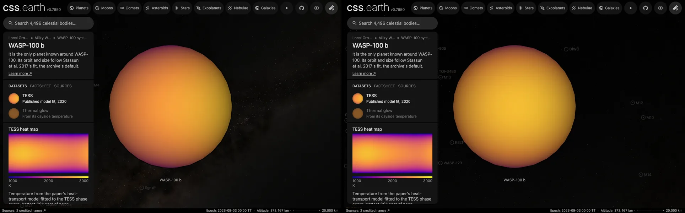

# WASP-100 b

## Sources

It is the only planet known around WASP-100. Its orbit and size follow Stassun et al. 2017's fit, the archive's default. The introduction is generated from Stassun et al. 2017's published values; the sections below are the data's own.

**Size and mass.** Radius 1.33 Jupiter radii from Stassun et al. 2017 (2017AJ....153..136S), via the NASA Exoplanet Archive (https://ui.adsabs.harvard.edu/abs/2017AJ....153..136S/abstract): 95,084.4 km at 71,492 km per Jupiter radius. GM from the mass 1.26 Jupiter masses (Stassun et al. 2017, the mass the NASA Exoplanet Archive's composite table adopts (2017AJ....153..136S), via the NASA Exoplanet Archive, https://ui.adsabs.harvard.edu/abs/2017AJ....153..136S/abstract) times JPL's Jupiter GM. A sphere: no oblateness is measured.

**Orbit.** ExoFOP, via the NASA Exoplanet Archive ps table (pl_refname EXOFOP): P 2.84938272598 d Stassun et al. 2017 (2017AJ....153..136S), via the NASA Exoplanet Archive ps table (pl_refname STASSUN_ET_AL__2017): a/R* 4.93; Stassun et al. 2017 (2017AJ....153..136S), via the NASA Exoplanet Archive ps table (pl_refname STASSUN_ET_AL__2017): inclination 82.6 degrees Stassun et al. 2017 (2017AJ....153..136S), via the NASA Exoplanet Archive ps table (pl_refname STASSUN_ET_AL__2017): e 0 ExoFOP, via the NASA Exoplanet Archive ps table (pl_refname EXOFOP): transit mid-time 2460988.068249 BJD, taken as BJD_TDB; with its period, the row that predicts 2026-01-01 best (1 sigma 1 min) Display convention: transit photometry does not measure the orbit's position angle on the sky, so the ascending node is set at position angle 0 (celestial north).

**Color.** A black body at the 2,350 K dayside brightness temperature measured in secondary eclipse at 3.6 µm (Deming et al. 2023, dayside brightness temperature at 3.6 µm (uniform reanalysis of Spitzer's eclipses, CDS J/AJ/165/104 table 2)): #ff9d3d. Chosen from the archive's emission rows by rule: 2 measured of 2 rows; the smallest relative uncertainty, then the longest wavelength. Reflected starlight is not included.

**TESS dataset.** Jansen & Kipping (2020, MNRAS 494, 4077, [arXiv:2001.10580](https://arxiv.org/abs/2001.10580), [doi:10.1093/mnras/staa814](https://doi.org/10.1093/mnras/staa814)) fitted WASP-100 b's TESS phase curve with a model of reflected light, the star's own variations and the heat of a temperature map following Cowan & Agol (2011): T = f T★ (R★/a)^½ (1 − A_B)^¼ cos(latitude)^¼ P(longitude), where P solves dP/dξ = (max(cos ξ, 0) − P⁴)/ε (their section 4). [The record](source/science/jansen-kipping-2020/energy-balance-map.json) keeps their fitted values, the posterior medians of their results table, A_B 0.24, ε 10.9 and f 1.22, with T★ 6,940 K and a/R★ 5.464 from their stellar density and period, the pair that gives their 2,099 K equilibrium temperature. The [energy-balance route](../../../packages/bake/src/objects/raster/eclipse-map/energy-balance-map.ts) solves the equation over whole turns until it repeats, as the paper solves it numerically, and draws the map as the model gives it, on a 1,000–3,000 K scale.

| Quantity | This map | Jansen & Kipping (2020) |
| --- | --- | --- |
| Hottest, on the equator | 2,707 K | 2,710 ± 100 K |
| Coldest, on the equator | 2,370 K | 2,380 +170/−200 K |
| Hottest longitude | 66° east | 71 +2/−4° east |
| Equilibrium temperature, A_B = 0 | 2,099 K | 2,099 ± 38 K |

The fit sets three numbers; the map's shape, cooler toward the poles as cos(latitude)^¼, is the model's. A measured map ranks above one color, so the page opens on it; Thermal glow follows.

**Charts.** The orbits of WASP-100's planets from above, from their hosted-orbit records, and its transit in 3 TESS sectors (96, 97, 98), folded onto its orbit. Upper limits and rows without an error are left out.

## Evidence

Generated 2026-10-15 by [new-object-cli.mts](../../../packages/telescope-cli/src/new-object/new-object-cli.mts); the orbit is the one recorded in [its astronomy record](../../../packages/astronomy/data/bodies/wasp-100b.json).

- The TESS dataset was added on 2026-10-15. [`energy-balance-map.test.mts`](../../../packages/bake/src/objects/raster/eclipse-map/energy-balance-map.test.mts) checks the model's energy balance (the mean of P⁴ over a turn is 1/π for any ε), its no-transport limit and its westward mirror, and that the record gives back the paper's printed extremes and equilibrium temperature; the system view's marker was redrawn from the map by [`context-markers.mts`](../../../packages/telescope-cli/src/source-authoring/context-markers.mts). In headless Chrome against the dev server the page opens on TESS, both datasets switch, and the console shows no error.

## Known problems

- **The TESS map is a model fitted to a phase curve.** Its shape is Cowan & Agol's; only the albedo, the heat transport and the heating factor come from the data. TESS sees visible light, where reflected starlight adds to the heat, and the paper separates the two with the same model. The map's hottest longitude, 66° east, is 1° short of the printed 71 +2/−4°: that value is a median over the fit's samples, the map the model of the median values.

[Investigation ledger](investigations.json) · [Inputs](source/manifest.json) · [Preparation](source/preparation) · [Delivered files](inventory.json) · [Credits](NOTICE.md)
